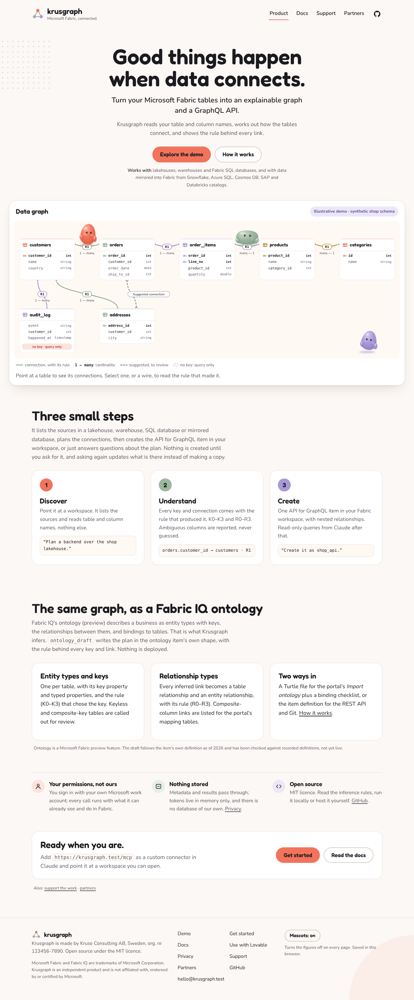

# Krusgraph finds the keys and relationships of your Microsoft Fabric tables and checks them against the rows; this repository is the Krusgraph source

The package is called `fabric-backend`: the engine, the MCP server, the website and the deployment of [Krusgraph](https://krusgraph.com), open source under the MIT licence.

**See how your tables connect: the rule behind every proposed link, and the row counts once you run the check.**

- Checked against your rows: every link shows its basis and the checks you run show their counts.
- Errors before anyone sees them: the total that doubles, keys that are not unique, references with no matching row.
- SAP knowledge from public sources ([krusgraph.com/sap](https://krusgraph.com/sap)): keys with MANDT and the order-to-cash links for VBAK, VBAP and their neighbours, each with its source. A second pack describes Younium subscription billing beside Salesforce (accounts and their External CRM Id, subscription versions, charges, invoices with lines, payments); its sources could not be opened from the session that wrote it and it is marked unverified throughout; the engine applies it since round n78 when a schema has a table of the systems' own (subscription versions, charge plans, opportunity line items), never on tables called accounts or invoices alone ([docs/YOUNIUM-SALESFORCE.md](docs/YOUNIUM-SALESFORCE.md)). The pack for the Nordic ERP systems is a spike so far ([docs/NORDIC-PACK-SPIKE.md](docs/NORDIC-PACK-SPIKE.md)).
- One checked plan, every starting point: in Fabric, from the plan you reviewed, Krusgraph creates silver and gold notebooks, a pipeline, a semantic model, a report and an ontology (each created live on synthetic data); creating a data agent or a new item for an API for GraphQL is experimental (an existing API was updated in place live), and an App (preview) is built by Krusgraph for Fabric only; the silver and gold tables fill when the pipeline runs. On /check, in your browser, the same plan gives drafts.

Hosted as **[Krusgraph](https://krusgraph.com)**: `https://krusgraph.com/mcp/connect` for Claude (with "Register
automatically") and for VS Code, Cursor and other MCP clients that register themselves (signed in and used on
27 October 2026 from VS Code, Cursor and Glama); Claude connectors added earlier at `https://krusgraph.com/mcp` keep
working; sign-in with your Microsoft work account, every call with
your own Fabric permissions. The [guided demo](https://krusgraph.com/demo)
and the [demo graph](https://krusgraph.com/explore) run the same engine on a synthetic schema and need no account. This
repository is the whole thing: engine, MCP server, website and deployment. Krusgraph is independent and not affiliated
with Microsoft; "Microsoft Fabric" is used descriptively.

**Try it without an account: [krusgraph.com/check](https://krusgraph.com/check).** No account, no Fabric and no
administrator needed. Drop CSV or Excel files, or paste a list of columns, and see how the tables connect and what is
wrong with them. The files are read in your browser and are not uploaded. No files at hand? Five synthetic examples
are one click away:

- **A total that doubles**: the shop (`fabric_backend/seed.py`, seven tables), the default sample everywhere.
- **SAP sales tables**: SAP-shaped sales, delivery and billing tables of two clients (`fabric_backend/sap_demo.py`).
- **Salesforce + ERP**: accounts on one side, an ERP's customers and orders on the other (`fabric_backend/browser_check.py`).
- **Subscription billing**: Younium- and Salesforce-shaped invoices (`fabric_backend/younium_demo.py`).
- **Manufacturing sample**: a fictional workshop with sixteen tables of its own design (customers, items, bills of
  materials, work centers, sales, purchase and production orders, stock movements, deliveries), two years of dates and
  a few planted problems to find ([docs/SAMPLE-MILL.md](docs/SAMPLE-MILL.md), `fabric_backend/mill.py`). To try it in
  Fabric: `seed(spark, mill=True)` writes it to a schema `mill` next to `shop`.



**The problem.** You have a lakehouse or warehouse in Fabric and you want an app on top of it —
in Lovable, or generated by an agent in Cursor or Claude Code. Those tools can read a Fabric
*API for GraphQL* item. They cannot make one. So before the first line of app code you spend an
afternoon in the portal: create the GraphQL item, pick tables, define every relationship by hand
(no relationships, no nested queries), register a service principal, grant it on the item, turn
on introspection, copy the endpoint. Then the schema changes and you do the relationships again.

Microsoft's own [GraphQL MCP server](https://learn.microsoft.com/fabric/data-engineering/api-graphql-local-model-context-protocol)
queries an API that already exists. Lovable's
[Fabric connector](https://docs.lovable.dev/integrations/microsoft-fabric) consumes one. As far as we have
found (October 2026), nothing provisions one from inferred relationships; if you know of something that does,
open an issue.

**What this does.** Reads the tables, infers keys and relationships from names (declared
constraints win when a warehouse has them), writes the GraphQLApi item definition with
ManyToOne / OneToMany relationships, creates the item — or updates it in place when the name
exists — and prints the endpoint plus the two portal clicks the API cannot do yet.

```python
%pip install git+https://github.com/Krusmaster/fabric-backend[deploy]
import fabric_backend as fb

out = fb.create(workspace="<workspace id>", source="my_lakehouse", name="shop_api", spark=spark,
                keys={"order_items": ["order_id", "line_no"]})   # optional here: rule K5 infers this one; `keys` overrides
print(out["plan"].summary())
print(out["card"])
```

```
7 tables, 6 with keys, 6 relationships
no key (query only; can reference others, cannot be referenced): audit_log
GraphQL endpoint:  https://api.fabric.microsoft.com/v1/workspaces/<ws>/graphqlapis/<id>/graphql
Still to do in the Fabric portal (no API for these yet):
  [ ] shop_api -> Settings -> Introspection -> On   (workspace admin; Lovable needs this)
  [ ] shop_api -> Manage permissions -> add the service principal with 'Run Queries and Mutations'
```

Paste the endpoint, tenant id, client id and secret into Lovable's Fabric connector. Done.

## Same thing from an agent (MCP)

```
pip install "fabric-backend[mcp]"
FABRIC_ODBC="Driver={ODBC Driver 18 for SQL Server};Server=<sql endpoint>;Database=<lakehouse>;Authentication=ActiveDirectoryInteractive" \
fabric-backend-mcp
```

The same engine over the one connection in `FABRIC_ODBC`: `list_tables`, `plan_backend` (keys, relationships,
Mermaid — nothing deployed), `validate_plan`, `sample_rows`, `create_backend`, `rayfin_connector`, `ontology_draft`,
`semantic_model_draft`, `join_path`, `data_dictionary`, `dbt_schema`, `analyze_schema`, `suggest_relationships` and
`create_views` (dry run by default). The tools that need Fabric item ids (`describe_backend`, `plan_drift`,
`app_starter`, `create_semantic_model`, `create_data_agent`) live in the remote server only. Set `FABRIC_SOURCE_KIND`
(`Lakehouse`, `Warehouse`, `SQLDatabase`) and `FABRIC_SCHEMAS_ENABLED=1` for a lakehouse created with schemas so that
`semantic_model_draft` writes `schemaName`; `SQLServer` for an on-prem or Azure SQL Server, where the two Fabric-only
drafts answer with an explanation. Windows set-up with Claude Desktop, Windows sign-in and what works locally:
[docs/LOCAL.md](docs/LOCAL.md). `fabric-backend demo` is the 20-minute demo on a laptop: one local page on 127.0.0.1
with the map, the health check with Accept / Skip and five questions run on the customer's own SQL Server or on a folder
of CSV / Excel files; script in [docs/DEMO-20-MIN.md](docs/DEMO-20-MIN.md). Add the stdio server to Claude Desktop
([docs/LOCAL.md](docs/LOCAL.md)) or another MCP client that starts local stdio servers; only the Claude Desktop set-up
is documented.
The agent can then say *"give me a GraphQL API over orders, customers and products"* and get an endpoint back.

## Remote server (Krusgraph: Claude, VS Code, Cursor and other MCP clients)

Add `https://krusgraph.com/mcp/connect` in Claude under Customize → Connectors → Add → Add custom connector, keep
"Register automatically" selected and sign in with your Microsoft work account; your Entra admin consents once
(https://krusgraph.com/start has the steps, https://krusgraph.com/docs the details). Why /mcp/connect: on 8 November
2026 Claude's new connector dialog registers itself as a client, which `https://krusgraph.com/mcp` does not offer
("Automatic client registration isn't supported"); connectors added there earlier keep working. VS Code, Cursor and
other MCP clients that register themselves use the same `https://krusgraph.com/mcp/connect`: Krusgraph shows its own approval page for
the client, then the Microsoft sign-in (https://krusgraph.com/docs#other-mcp-clients; tested on 27 October 2026 with
VS Code, Cursor and Glama; [docs/CLIENT-REGISTRATION.md](docs/CLIENT-REGISTRATION.md)). The first message after
connecting: `start Krusgraph`, a guided path one step at a time that only reads until you confirm the names after a dry
run ([docs/START-KRUSGRAPH.md](docs/START-KRUSGRAPH.md)). To run your own:

```
docker build -t fabric-backend-server . && docker run -p 8000:8000 \
  -e FABRIC_TENANT_ID=... -e FABRIC_CLIENT_ID=... -e FABRIC_CLIENT_SECRET=... fabric-backend-server
```

Streamable HTTP at `/mcp`, forty tools, every one with a `title` and a `readOnlyHint`/`destructiveHint`
(the directory requires it): `list_workspaces`, `list_sources`, `list_tables`, `plan_backend` (nothing deployed; suggests
composite keys), `sample_rows`, `validate_plan` (keys and relationships checked against the rows; by default a summary with every failing check in full, `detail="full"` for every check), `create_backend`
(creates or updates one item, never deletes), `describe_backend`, `query_graphql` (read-only; mutations refused),
`rayfin_connector` and `ontology_draft`; every tool takes the workspace by id or name. Five more read-only tools turn the
same plan into the week's deliverables, all unit-tested and run against the demo workspace (synthetic shop data) on 26 and 27 October 2026:

- `semantic_model_draft` — a Power BI semantic model in TMDL: Direct Lake tables on the SQL analytics endpoint,
  relationships with one active path per table pair, suggested measures with their reasons (the row count of each fact
  table, sums only where `summarizeBy` sums; never an id, code or year) and, when fact tables have date columns, a
  calendar marked as the date table; a `README.generated.md` with the decisions to check
  (`fabric_backend/semantic_model.py` cites the Microsoft sample definitions it follows). The measures and the calendar
  were added after 26 October and came back from the live run of 27 October (`summarizeBy: none` on `ship_to_id`).
- `join_path` — the shortest chain of relationships between two tables, rule per hop, ready T-SQL; or which
  relationship is missing.
- `data_dictionary` — hand-over documentation in Markdown with an empty Description column; `validate=true` adds counts.
- `dbt_schema` — a dbt sources file with `unique`, `not_null` and `relationships` tests (`fabric_backend/dbt.py` cites the dbt docs).
- `domain_draft` — proposed domains (candidate data products) from the plan's graph, the relationships that cross them,
  unassigned tables and one ODCS v3.2.0 data contract per domain; Fabric domains are created by the customer's admin
  ([docs/DOMAINS.md](docs/DOMAINS.md)). Unit tests only.
- `plan_drift` — today's plan against an existing API for GraphQL item: what a `create_backend` with that name would change.

Four more tools create things from the same plan, each `dry_run=true` by default so the first answer is exactly what
would be created, each creating or updating in place under a name and never deleting (`create_report` only creates); all unit-tested with Fabric
mocked. On 27 October 2026 the first three ran as dry runs against the demo lakehouse; `create_semantic_model` then created `shop_model_live` live on 29 October 2026 (reviewed in the Fabric portal the same day; `shop_model` updated in place from Lovable on 30 October 2026) and `create_report` created `shop_report_live` and `shop_report` live on 30 October 2026 (opened and reviewed in the Fabric portal the same day) and its first page with visuals, `shop_report_visuals`, on 7 November 2026 (every figure checked in Power BI; the n151 look has not run live), while creating with `create_views` or `create_data_agent` is unit-tested only (the status per tool: https://krusgraph.com/docs#test-status). The delegated permissions they need, against what the app has today, and
the `az` commands to add them are in [docs/SCOPES.md](docs/SCOPES.md):

- `create_semantic_model` — a SemanticModel item from the TMDL draft (`POST /semanticModels`, `updateDefinition`); needs
  `SemanticModel.ReadWrite.All` or `Item.ReadWrite.All` (`Item.ReadWrite.All` granted since 28 October 2026).
- `create_views` — `CREATE OR ALTER VIEW` in a schema of its own (`krusgraph`) on the SQL analytics endpoint or
  warehouse: a wide view per fact table, one per header table (`vw_orders`: each order with its customer and, once
  `orders.ship_to_id` is confirmed, its ship-to address; in the dry run of 27 October, not yet created live) and one per hard-to-read
  relationship; needs no new scope, only the SQL right to create objects.
- `create_data_agent` — a Fabric data agent through the public staging API: the plan as instructions, the source as
  data source, 5–10 example questions with T-SQL, published; needs `Item.ReadWrite.All` (granted since 28 October 2026).
- `create_report` — a Power BI report bound to an existing semantic model, with one page drawn from the model's own
  measures and columns (PBIR definition, built from the model's TMDL read with getDefinition): cards for the row counts
  of business tables and the units (a table without a key or relationship, or named like a log, gets none), a clustered
  column chart by the date table's Year Month (or Month), a clustered bar chart by the most-referenced dimension, and a
  table of the nearest dimension sorted by a measure with a total row. Since round n151 the page has plain titles
  ("Orders", "Order lines", "Units", "Units by category"; any other measure keeps its own name), fills 1280 × 720 in a
  grid, carries a page title "Overview · <model>", a footnote with the date, data labels, a month and a category slicer
  when those fields exist, and the Krusgraph theme from the site's colours (a `StaticResources` part). A plain SUM of a
  column the model does not sum, or of a header amount copied onto lines, is never drawn (`left_out` says why;
  `not_drawn` names a visual or card the page goes without); when nothing can be drawn the page is left blank.
  `empty_page=true` creates one blank page instead (`POST /reports` with `creationPayload.semanticModelReference`). A
  report of that name is left alone, never updated or deleted; needs `Report.ReadWrite.All` or `Item.ReadWrite.All`, and
  `SemanticModel.ReadWrite.All` to read the model. Tried live: the blank-page report was created live on 30 October
  2026 (`shop_report_live`, `shop_report`), opened and reviewed in the Fabric portal by Gustav the same day; the page
  with visuals was created live on 7 November 2026 (`shop_report_visuals` on `shop_model`, every figure checked in Power
  BI) and is unit-tested against Microsoft's published PBIR schemas; the n151 look has not run live.
- `app_starter` (read-only) — a Lovable prompt, connection details, five GraphQL queries, the portal checklist and the
  backend an app needs so that no secret reaches the browser: a Supabase edge function that gets the token with the
  app's service principal and forwards the queries, the secrets as Supabase secrets, the frontend helper, and the
  per-user alternative (Supabase Auth with Entra, the user's own token forwarded). Drafted live on 27 October; the
  edge function itself has not been deployed.
- `app_readiness` (read-only) — what an app still needs on an existing API: keyless types, unlinked types, write access
  from the definition, introspection from one probe query, and "unknown" with the click path for what Fabric's API
  cannot read (permissions, the tenant setting). Unit-tested and run live on 27 October. The whole Lovable chain, step by step with owners and
  blockers, is in [docs/LOVABLE-END-TO-END.md](docs/LOVABLE-END-TO-END.md).

From understanding to building ([docs/NOTEBOOKS.md](docs/NOTEBOOKS.md); unit-tested, the generated notebooks also ran
on a local PySpark; the drafts and `answer_query_draft` ran live on 27 October; the silver and gold notebooks that
`create_pipeline` writes from these drafts ran in Fabric on 7 November 2026, run 9de8bc49, all three steps succeeded;
the notebooks the creating tools below made on 28 October have not been run in Fabric):

- `silver_notebook_draft` / `create_silver_notebook` — a PySpark notebook for a lakehouse that writes silver tables in a
  schema of their own: de-duplicated on each key (latest row by `order_by` wins), every reference checked with the rows
  whose reference is missing in `krusgraph_quarantine` with the reason, each step commented with its rule, re-runnable,
  never over a source table. The create is a notebook item (`Notebook.ReadWrite.All`, granted since 28 October 2026); it runs nothing.
- `drift_monitor_draft` / `create_drift_monitor` — a notebook and a pipeline that every night compare the plan with the
  last one, save it in `krusgraph.plans`, and send a short summary of what changed and which APIs, models and views it
  reaches to a webhook set as a pipeline parameter in Fabric; plus the daily schedule. The pipeline needs `DataPipeline.ReadWrite.All` (granted since 28 October 2026); the
  schedule needs `DataPipeline.Execute.All`, opt-in on the hosted app (`pipeline_execute`, round n220), so `schedule=false` is the default.
- `answer_query_draft` — a question in Swedish or English about some tables as T-SQL over the safest join path (each
  step with its rule) and, for an existing API, as GraphQL; `query_graphql` with `question` runs the GraphQL version.
- `gold_views_draft` / `create_gold_views` — materialized lake views in Spark SQL over the silver tables: one wide view
  per fact table in a schema of its own (`gold`), joined over the safest many-to-one paths, with a `CONSTRAINT … CHECK …
  ON MISMATCH DROP` rule for the fact's key and the relationships' rules in the SELECT's WHERE (a reference that finds
  nothing is left out, a NULL one kept), each commented with its rule; each join key appears once, under the
  referencing column's name (no `orders_order_id` next to `order_id`); the notebook stops before
  a source, silver or foreign table (`fabric_backend/gold.py` cites the syntax and status from Microsoft Learn). The
  SQL ran on SQLite and a local PySpark 4.0.1 (open-source Spark has no materialized lake views, so the CREATE itself is
  checked against the documented syntax); in Fabric, inside `create_pipeline`'s run of 7 November 2026 (run 9de8bc49).

Existing models, Git and personal data (round n12, unit-tested; on 27 October `export_item_definitions` ran live as a
draft and `compare_semantic_model` only as far as the model lookup, the demo workspace having no model):

- `compare_semantic_model` (read-only) — an existing Power BI semantic model against the plan: relationships the model
  lacks, ones a rule or the data contradicts, other cardinality, both-way filters, active against inactive, links the
  plan lacks (with a `confirmed` entry), columns summed against the `summarizeBy` rule, suggested measures it lacks. It
  reads the model's TMDL through Fabric's getDefinition (`SemanticModel.ReadWrite.All` or `Item.ReadWrite.All`; the app
  has `Item.ReadWrite.All` since 28 October 2026, and the read-only executeQueries is documented as not supporting the INFO functions), or the TMDL files you
  pass from a PBIP folder or Git, which needs no permission. Fixture: `tests/fixtures/semantic_model_shop`.
- `export_item_definitions` (read-only) — what the creating tools would create, as folders in Fabric's Git format
  (`<name>.<type>` with `.platform` and the definition files) for your own repository, so that Fabric's Git integration
  or a deployment pipeline makes the change; calls no Git provider.
- Personal data (`fabric_backend/privacy.py`) — columns flagged by name, one rule per pattern (name, e-mail, phone,
  national id, address, birth date), masked in `sample_rows`, left out of drafted queries and gold views, masked in the
  silver quarantine; `show_personal_data=true` shows them. The source item's sensitivity label id is named when Fabric
  returns one.

Beside Microsoft's own Fabric MCP servers (the Fabric MCP Server and Fabric Core for workspaces, items and files; Fabric
IQ MCP for questions to semantic models; the Power BI Modeling MCP server for editing a model), Krusgraph is the part that
works out how the tables relate and builds from that plan: https://krusgraph.com/docs#with-microsoft-s-fabric-mcp-servers.
Krusgraph is not affiliated with Microsoft.

Two read-only tools look at the plan as a graph (`fabric_backend/graphs.py`, pure Python, deterministic; unit-tested and
run against the demo workspace (synthetic shop data) on 26 and 27 October 2026):

- `analyze_schema` — table roles (fact, dimension, bridge, isolated) with the numbers behind them, the ten most central
  tables (degree, betweenness, PageRank), subject areas, cycles and table pairs with more than one path, and which
  relationships can be active at once in a semantic model (maximum spanning forest by certainty).
- `suggest_relationships` — columns that could point at another table's key but are in no relationship, ranked by name,
  type and triangular closure, the best fifteen checked against the data (inclusion share, distinct values); suggests only.
- `lineage` — which objects in the workspace build on the source's tables: GraphQL APIs (their definition), semantic
  models (their TMDL), views on the SQL endpoint (`INFORMATION_SCHEMA.VIEW_TABLE_USAGE`), data agents (named in their
  definition, marked as not certain); the objects per table, the tables used by nothing, and with `table` what a change
  reaches. `plan_drift` names the same objects for the tables and columns a re-run would drop (`impact`). Unit-tested
  with Fabric mocked and run live on 27 October (where it skipped `shop_api`, fixed since and unit-tested). A plan covers one schema of one source item; tables a
  lakehouse holds as shortcuts are part of it. A graph over several sources is a design note only:
  [docs/MULTI-SOURCE.md](docs/MULTI-SOURCE.md).

### How the graph is weighted

| Origin of a relationship | Certainty | Used for |
| --- | --- | --- |
| Declared foreign key (R0) or `confirmed` | 1.0 | |
| Any rule, when `validate_plan` found no orphans | 0.9 | safest `join_path`, active relationships in `semantic_model_draft` |
| R1 (column named after the table) | 0.8 | |
| R2 (column with the target key's name) | 0.6 | |
| R3 (composite key present), R4 (role prefix or abbreviation) | 0.5 | |
| R5 (code or role column, values counted in the rows): no own weight, the default | 0.5 | 0.9 once validate_plan finds no orphans |

Cost is 1/certainty; the shortest path counts hops, the safest path minimises cost, and when they differ `join_path`
says why. Roles come from in/out degree, betweenness and the share of measure-like columns; subject areas from label
propagation with a fixed order; ambiguity from the relationships a spanning forest leaves out (each closes a cycle). The tool table with arguments
and an example question per tool is on https://krusgraph.com/docs. Authentication: a `Authorization: Bearer` Fabric
token on the request wins; otherwise the server's own service principal — the same model as
Lovable's Fabric connector. The server keeps nothing between requests (no database, no files). Put TLS in front, add it to Claude as a
custom connector with the `https://…/mcp` URL, and the loop is browse → plan → create → query.
The local stdio server (`fabric-backend-mcp`, ODBC string) stays for single-user use.

**Sign-in with Microsoft (how krusgraph.com runs).** Set `MCP_PUBLIC_URL`, `ENTRA_CLIENT_ID` and
`ENTRA_CLIENT_SECRET` and the server switches to per-user Entra sign-in: unauthenticated calls get the `401` with
a `resource_metadata` pointer that Claude needs, `/.well-known/oauth-protected-resource` describes the resource,
each user's token is validated (issuer per tenant, audience = the app, signature) and exchanged on-behalf-of for
Fabric and SQL tokens — every call runs with that user's own Fabric permissions. The delegated permissions the
Entra app asks for (7 November 2026): `User.Read`; Fabric `Workspace.Read.All`, `Item.Read.All`, `GraphQLApi.ReadWrite.All`,
`GraphQLApi.Execute.All`, `Notebook.ReadWrite.All`, `DataPipeline.ReadWrite.All`, `Item.ReadWrite.All` (the last three
since 28 October 2026); Azure SQL `user_impersonation`. Opt-in (round n220): `DataPipeline.Execute.All`, so that
`create_pipeline` can run or schedule its pipeline after a dry run and your confirmation. Not requested: `Item.Execute.All`. What each tool uses them for: [docs/SCOPES.md](docs/SCOPES.md). Metadata, the counts from the checks, requested sample rows
and query results pass through the server in memory only and are not kept; Claude's tokens stay in memory, and the only
stored records are the encrypted sign-in records of other MCP clients described below. Each tool call leaves an anonymous
usage record, and `/privacy` says which technical logs the deployment keeps. MCP clients other than Claude (VS Code, Cursor, Glama)
register themselves as OAuth clients, which Entra cannot do; `KRUSGRAPH_CLIENT_REGISTRATION=1` serves them at
`/mcp/connect` through Krusgraph's own authorization server at `/oauth` in front of Entra: Client ID Metadata Documents,
optional strict dynamic registration, a consent page of Krusgraph's own per client, PKCE S256, and the same token
validation as `/mcp`, with a few short-lived sign-in records in Azure Table Storage; Claude's sign-in at `/mcp` is
unchanged either way ([docs/CLIENT-REGISTRATION.md](docs/CLIENT-REGISTRATION.md); off by default; switched on at
krusgraph.com since 27 October 2026, where VS Code, Cursor and Glama signed in on 27 October and Lovable on 30 October
2026, while Claude Code has not been tried: the status per client is on https://krusgraph.com/docs#test-status). The same process serves the website (`/`, `/check`, `/start`,
`/support`, `/partners`, `/docs`, `/privacy`; static files under `fabric_backend/static/`, no external resources).
Operations ([docs/OPERATIONS.md](docs/OPERATIONS.md); unit-tested, not deployed): fair-use limits per user and per
organisation (`kind: rate_limited` with `retry_after`; `KRUSGRAPH_RATE_*`), one anonymous usage line per tool call and a
token-protected `/metrics` (off by default), `/health` for uptime checks, the client secret optionally from Azure Key Vault
(`ENTRA_CLIENT_SECRET_KEYVAULT_URI`, set up by `deploy/krusgraph.sh --key-vault`), and a dormant paid-plan check
(`KRUSGRAPH_ENTITLEMENTS`, off; [docs/PRICING-NOTES.md](docs/PRICING-NOTES.md)). For the person on duty,
`deploy/krusgraph.sh --doctor` (one table of the service's state, reads only), `--budget` (a cost budget with e-mail)
and `--backup` (the registration table's consent records to a file), with a continuity checklist, are sections 8
and 9 of the same file.
`PRODUCT_NAME`, `CONTACT_EMAIL` and the optional `COMPANY_ORGNR` fill the pages; `KRUSGRAPH_BUILD` (set by the deploy script to the image's source tag) is echoed on `/healthz` so a deploy can tell the new revision from the old one; `KRUSGRAPH_DEBUG_ERRORS=1` adds the exception class to tool error answers, for an operator debugging a case; `KRUSGRAPH_ONTOLOGY_WRITE` (deploy config `ontology_write`) is no longer read: `create_ontology` is always offered, dry run by default; `PARTNER_SIGNIN=1` shows a
not-yet-wired partner sign-in button. `deploy/` has the Azure Container Apps deployment (`krusgraph.sh`,
`--check`, `--update`, `--status`, `--key-vault`; exact image versions in `deploy/constraints.txt`; see `deploy/KRUSGRAPH-START.md`), the synthetic demo dataset
(`fabric_backend.seed`) and the directory submission draft (`deploy/SUBMISSION.md`). Tool failures come back
as `{"error", "kind", "hint"}` (`fabric_backend/errors.py`): an unknown workspace, a missing or paused
capacity, an expired sign-in or missing consent, a missing schema or table, a timeout, each in plain words and
never with a token, a header or a traceback.

## How the relationships are inferred

A lakehouse SQL endpoint has no keys and no foreign keys, so names are all there is. Every result
carries the rule that produced it, and you can overrule any of them.

| Rule | Keys | | Rule | Relationships |
| --- | --- | --- | --- | --- |
| K0 | declared primary key | | R0 | declared foreign key |
| K1 | `keys={"order_items": ["order_id", "line_no"]}` | | R1 | column `<table>_id` / `<singular>_id` → that table's single key |
| K2 | `id`, `<table>_id`, `<singular>_id`, `<table>_key`, `<table>_code`, or an abbreviation of four letters or more (`cust_key`) | | R2 | same name as another table's single key (`werks` → plant); plain `id` never matches |
| K3 | none → query only, nothing can point at it | | R3 | all columns of another table's composite key are present |
| K4 | junction: the table starts with two or more reference columns (`film_actor`: `actor_id` + `film_id`) | | R4 | weaker match when R1/R2 find nothing: a role before the name (`manager_staff_id` → staff) or an abbreviation (`o_custkey` → customer) |
| K5 | line: the header reference plus a line-number column (`order_items`: `order_id` + `line_no`) | | R5 | only with rows (`plan(..., execute=...)`, which plan_backend and every hosted tool pass since round n87; `/check` plans by the names and counts the plan with validate_plan): a code column `<stem>_code`/`_no`/`_key` (`currency_code` → `currencies.code`, `ERP_Customer_No__c` → `customers.customer_no`) or a role name (`ship_to_id` → addresses, `created_by` → users), planned when every value is in the target's key, same type family, two or more distinct values and one table fits; otherwise `plan.proposed` with the reason |

Names are compared without case, separators or a table-wide column prefix (`N_NATIONKEY` in `NATION` reads as
`nationkey`), and `<X>Header` also answers to `<X>`. How well this works on Northwind, Chinook, TPC-H,
AdventureWorks and Sakila, from names alone, is measured in [docs/INFERENCE.md](docs/INFERENCE.md).

A column that could point at two tables (`user_id` with both `users` and `user` present) is
reported under `plan.ambiguous` and not applied. A column no name rule matches (`ship_to_id` in the demo schema) is
left unlinked by names alone; with the rows (R5) it is linked when its values say so, and `confirmed=[...]` adds it
otherwise. Two columns pointing at the same table get fields
named by column (`airport_by_origin_airport_id`). Anything the rules miss goes in `confirmed=[...]`
and is applied first. An entry can name the two GraphQL fields too: `field_name` on the source and `reverse_name` on
the target (`{"source": "orders", "source_cols": ["ship_to_id"], "target": "addresses", "target_cols": ["address_id"],
"field_name": "address", "reverse_name": "orders"}` gives `orders.address` and `addresses.orders`); without them the
rules name the fields. Updating an existing API, `create_backend` keeps the names it already has for the same
relationship (the same columns in the same direction) unless the entry names them otherwise.

Dry run without deploying:

```python
p = fb.plan_from(spark=spark)          # or execute=<callable running SQL against the endpoint>
print(p.summary()); print(p.mermaid())
```

Offline, from an `INFORMATION_SCHEMA.COLUMNS` export:

```
fabric-backend plan columns.csv --keys keys.csv --mermaid er.mmd
fabric-backend definition columns.csv --name shop_api --workspace <ws> --source-item <sql endpoint id> --out def.json
fabric-backend deploy def.json --workspace <ws>
```

The consultant outputs from the same CSV, nothing created: `semantic-model` (TMDL folder, `--sql-endpoint`,
`--source-name`, `--source-kind`, `--schemas-enabled`), `join-path START END` (the chain with its T-SQL, exit 1 and a
suggestion when there is none), `dictionary` (Markdown), `dbt` (sources yml, `--legacy-arguments` for dbt before
1.10.5), `analyze` (roles, central tables, areas, ambiguity; `--json` for the full graph) and `views` (the
`CREATE OR ALTER VIEW` statements to run yourself, `GO` between the batches). `fabric-backend --help` lists them.

When a literal name finds nothing, a small documented synonym table is tried (abbreviations such as `cust`, `prod`, `ord`,
`emp`; Swedish and German business words; `dim_`/`fact_`/`tbl_` prefixes; `_sk`/`_bk` suffixes), after transliteration of
`å ä ö ü ß`. Such a match counts as R4, carries a `note` on the relationship and is listed under `plan.synonyms`. The
benchmark in `docs/INFERENCE.md` shows before and after on eleven schemas.

## Same plan, second output: Rayfin (Fabric Apps) connector entities

[Rayfin](https://www.microsoft.com/microsoft-fabric/features/rayfin) is Microsoft's open-source
backend SDK for apps on Fabric (Build 2026; Replit is the launch partner). It reaches existing
tables through *connectors*: `npx rayfin connector add` discovers the schema, and then
[every entity class is written by hand](https://learn.microsoft.com/fabric/apps/connectors) —
decorator per column, key per table, and no syntax for relationships between connector entities
in the docs. This writes them from the same plan:

```python
files = fb.rayfin_files(out["plan"], connector="shop")        # also in out["rayfin"] after fb.create
fb.write_rayfin(files, root="path/to/your/rayfin-app")        # rayfin/connectors/shop/*.ts + schema.ts
```

```typescript
// rayfin/connectors/shop/Orders.ts — generated
@role('authenticated', ['read'])
@entity()
// key order_id by rule K2  (by name — remove primaryKey if that is wrong)
export class Orders extends Source({ schema: 'dbo', table: 'orders', primaryKey: ['orderId'] }) {
  @int({ column: 'order_id' }) orderId!: number;
  @int({ column: 'customer_id' }) customerId!: number;
  @date({ column: 'order_date' }) orderDate!: string;

  @one(() => Customers, { sourceFields: ['customerId'], targetFields: ['customerId'] }) customer?: Customers;   // [R1]
  @many(() => OrderItems, { sourceFields: ['orderId'], targetFields: ['orderId'] }) orderItems?: OrderItems[];  // [R1]
}
```

Offline: `fabric-backend rayfin columns.csv --keys keys.csv --connector shop --out .`, or straight
from the `metadata.json` that `npx rayfin connector add` writes (`fabric-backend rayfin
rayfin/connectors/shop/metadata.json --schema shop ...`) — it has columns and types but no keys,
so inference still runs. The full output for the synthetic schema is in `examples/rayfin/`. From
an agent: the MCP tool `rayfin_connector`.

The generated connector is **read-only by default**: `schema.ts` and `src/lib/connectors.ts` set
`operations: ['read']`, and the README's `npx rayfin connector add` step passes `--operations read`. Rayfin 1.36.2
allows every CRUD verb (`read`, `create`, `update`, `delete`) when `operations` is left out, so the files always name
it; `rayfin_files(..., operations=["read", "create"])` widens it where an app must write. Relationships confirmed by
the caller or counted in the rows (rule R5, such as `orders.ship_to_id` → `addresses.address_id` in the synthetic
shop) are generated as `@one` / `@many` like the name rules' ones.

Two things the Rayfin docs do not say, learned from running it: `@one`/`@many` work on connector
entities **only with `sourceFields`/`targetFields`** — without them Rayfin invents a column
(`customer_customer_id`) and the query fails; and `@date()` properties are typed `Date`, not
`string`. Both are generated. The docs do say *don't infer a primary key from a column name*; this
does, and prints the rule beside every key so you can take it out.

Besides the connector's entities, the output has the app side, written at the project's root (in a `blankapp` project,
where `packages/frontend/package.json` exists, `src/` goes under `packages/frontend/`):

- `src/lib/connectors.ts` wires the connector into the app (`AppConnectorsSchema`, `connectorConfigs`,
  `connectorRuntimes` and `getConnectorsClient()`, a `ConnectorsRayfinClient` from `@microsoft/rayfin-client`). It
  imports the connector's `schema.ts` with `import type` only and lists each entity's columns by name, checked against
  the entity types; that is the form `@microsoft/rayfin-connectors` recommends for code the browser loads, because a
  decorated entity class cannot be bundled.
- `src/pages/<Table>Page.tsx` lists the latest rows of one table through the connector (`--page-table`, by default a
  fact table): an explicit column list, newest first by the first date column, else by the key.
- `rayfin/tsconfig.json`, the one in the `data-app` template of `@microsoft/rayfin-cli` 1.36.2, written only where the
  project has none.

Columns that look like personal data by name are left out of the page and of the default columns; the entity classes
still describe them.

### Publishing in Fabric

Use the `blankapp` template. On 6 November 2026 both templates were created with the 1.36.2 npm packages (no login, no
`rayfin up`) and the files generated for the shop example dropped in:

| Template | Hand changes before `tsc` and `npm run build` pass |
| --- | --- |
| `blankapp` (after `npm run pack:add -- connectors`) | none; the app files go under `packages/frontend/src/`, which `--out .` does |
| `dataapp` (built for semantic models) | three in the template's files: keep the `SemanticModelConnectors` type in `src/lib/connectors.ts`, give `new ConnectorsRayfinClient` in `src/lib/rayfin-client.ts` its type arguments, cast through `unknown` in `src/hooks/use-semantic-model-query.ts`; the template's `src/lib/connectors.spec.ts` then fails two tests that expect the CLI's marker |

The steps below are those of the run of 5 November 2026 (Rayfin 1.36.2, synthetic lakehouse, `dataapp`), with that
run's hand steps replaced by the generated files and the template changed to `blankapp`; the generated
`README.generated.md` repeats them with your connector's name.

First, a Fabric admin turns on the tenant setting "Enable Fabric App Items (preview)" (`AppBackendTenant`) in the
Admin portal. Until it was on, `npx rayfin up` failed with 403 "The feature is not available". An admin can read the
setting with `GET /v1/admin/tenantsettings`. Leave anonymous data access off.

1. `npm create @microsoft/rayfin@latest -- <app> --template blankapp --workspace "<workspace>"` (in Windows PowerShell
   `npm.cmd create ...`), then `cd <app>`.
2. `npm run pack:add -- connectors` (the template's step for existing Fabric sources).
3. `npx rayfin login`
4. `npx rayfin connector add --type fabric-sqlanalytics --workspace-id <ws> --item-id <item> --name shop --operations read`,
   then run the `npm install` it prints, inside the project. It may say it wired nothing: it wires a connector only
   once `schema.ts` exports `connectorConfig`, and at this point `schema.ts` is still a placeholder.
5. `fabric-backend rayfin rayfin/connectors/shop/metadata.json --schema shop --connector shop --out .`
6. Review the keys: delete `primaryKey` where a K2 key (inferred from a column name) is wrong.
7. Use the generated files: in `packages/frontend/src/App.tsx`, render the generated page (`<OrderItemsPage />` for the shop example) in
   place of the template's placeholder.
8. `npx tsc -p rayfin/tsconfig.json --noEmit`, `npm run typecheck` and `npm run build`
9. `npx rayfin up --workspace <workspace>`; when asked, choose that visitors must sign in.
10. If the connector step failed: `npx rayfin up connector apply --name shop`. A failed connector apply ("No usable
   compiled connector entities") does not make the deploy report failure, so read the warnings.

What was verified: in the run of 5 November a published app showed rows from a table through the connector, with
`src/lib/connectors.ts` and the page written by hand (`connector add` had printed "Wired 0", and importing the entity
classes with their decorators had stopped the build, so the page imported the schema as a type only and passed
explicit column lists). The generated files do the same things. `tests/test_rayfin_app.py` compiles them, the page
included, with `tsc` against `@microsoft/rayfin-*` 1.36.2 and TypeScript 5.7.3 (pinned in
`tests/fixtures/rayfin_check/`), in a project laid out like the `dataapp` template and in one laid out like the `blankapp` template after
`pack:add -- connectors`. What was not: the generated files have not been deployed to Fabric or opened in a browser,
and no app has been published from a `blankapp` project; sign-in, the connector apply and reading rows happen only
there.

## Sources it can expose

| Source | `sourceType` | Writes | Rayfin connector |
| --- | --- | --- | --- |
| Lakehouse | SqlAnalyticsEndpoint (the endpoint's id, resolved for you) | no | `fabric-sqlanalytics` |
| Mirrored database (Snowflake, Azure SQL, Cosmos DB, SAP via Datasphere, ...) | SqlAnalyticsEndpoint | no | `fabric-sqlanalytics` |
| Mirrored Azure Databricks catalog | SqlAnalyticsEndpoint (via the item's SQL analytics endpoint) | no | `fabric-sqlanalytics` |
| Snowflake database (Fabric item) | SqlAnalyticsEndpoint (via the item's SQL analytics endpoint) | no | `fabric-sqlanalytics` |
| Mirrored catalog (preview) | SqlAnalyticsEndpoint (via the item's SQL analytics endpoint) | no | `fabric-sqlanalytics` |
| Warehouse | Warehouse | `writable=True` → Create/Update (Delete stays off) | `fabric-warehouse` |
| Fabric SQL database | SqlDbNative | `writable=True` | `fabric-sqldatabase` |

**Fabric IQ.** `ontology_draft` (remote server), `fabric-backend ontology` (CLI) and `fabric_backend.ontology_files`
write the plan as a Fabric IQ ontology (preview): entity types with a key and properties, relationship types, data
bindings, in the item's generation-2 definition (TMDL parts for `POST /workspaces/{id}/ontologies` or Git) plus a
Turtle file for the portal's *Import ontology* and a binding checklist. Creating the item needs `Item.ReadWrite.All`;
`create_ontology` creates or updates the item from the same plan (dry run by default; without the permission it answers
`consent` naming the scope). Checked against recorded definitions and the specification's examples, not live yet.

**Snowflake and Databricks.** Two routes. (1) Bring it into Fabric (a Snowflake database item or a Mirrored database for
Snowflake, a Mirrored Azure Databricks catalog or a Mirrored catalog for Unity Catalog) and the item is a source like any other: the remote tools list it,
plan it and build the API for GraphQL item over its SQL analytics endpoint. (2) Plan directly: `plan_from(execute=...)`,
the CLI and the local stdio server read `INFORMATION_SCHEMA` the same way on Snowflake and Databricks as on Fabric
(Snowflake has no `KEY_COLUMN_USAGE`, so keys come from names there; Unity Catalog's informational constraints are
read as K0/R0). That route gives the explainable graph, the Mermaid diagram and the Rayfin entities; the API for
GraphQL item itself is a Fabric object, so route (2) ends at `dry_run`/`definition` unless the data is mirrored.
Since round n13 the local stdio server also has a Databricks adapter (`KRUSGRAPH_PLATFORM=databricks`; **Draft only**:
unit-tested with Databricks mocked, not yet run against a workspace): it reads a Unity Catalog schema with its
informational constraints and column tags, runs the checks on a SQL warehouse through the Statement Execution API, and
drafts informational constraints, views, a Lakeflow pipeline with expectations, metric views and a bundle from the plan
([docs/DATABRICKS.md](docs/DATABRICKS.md)). The hosted server reads Fabric only.
The item types, routes and `sqlEndpointProperties` follow Microsoft's published REST specification; a live run of these
source types is still pending.

For SAP tables the names say nothing (`VBELN`, `KUNNR`); use
[sap-ontology](https://github.com/Krusmaster/sap-ontology), which derives the graph from SAP's own
data dictionary and exports the same GraphQLApi definition — that is the SAP adapter for this.

## Two clicks remain

Introspection and item permissions are portal-only as far as we can tell (October 2026): the public docs list no
REST route for either, and the connection card says so instead of pretending. Tenant setting *"Service principals
can call Fabric public APIs"* is an admin task once per tenant. If you know a programmatic way for
either, open an issue.

## Evidence

What is measured or recorded, and where; no claim beyond what these say.

- **Benchmark** on four synthetic sets (shop, SAP-shaped, Salesforce-shaped + ERP, built traps) against an approximation
  of Power BI's documented autodetect rules and dbt-style tests, with its limitations stated:
  [examples/benchmark/README.md](examples/benchmark/README.md); `tests/test_benchmark.py` checks that a new run gives the
  same table. Inference on eleven schemas from names alone: [docs/INFERENCE.md](docs/INFERENCE.md).
- **Live test checklist** and the protocol behind every status word, with dates: [docs/LIVE-TEST.md](docs/LIVE-TEST.md).
- **Status per tool**, rendered from `fabric_backend/tool_status.py`: https://krusgraph.com/docs#test-status.
- **What is still missing** for the sales deck, the Marketplace listing and the connector application, and who takes it:
  [docs/MISSING-EVIDENCE.md](docs/MISSING-EVIDENCE.md).
- **Trust, risk and licences**: what may be said about security and data handling, each statement with its source in the
  repository ([docs/TRUST.md](docs/TRUST.md)); the ISO/IEC 27001:2022 Annex A controls, in place, partly, missing or not
  applicable, with no score ([docs/ISO27001-SELF-ASSESSMENT.md](docs/ISO27001-SELF-ASSESSMENT.md)); Krusgraph holds no
  ISO 27001 or SOC 2 certification. The licences of every dependency, generated from the pins:
  [THIRD_PARTY_NOTICES.md](THIRD_PARTY_NOTICES.md). Related MCP servers and Krusgraph's place beside Microsoft's:
  [docs/ECOSYSTEM-WATCHLIST.md](docs/ECOSYSTEM-WATCHLIST.md), [docs/COMPANION-MCP.md](docs/COMPANION-MCP.md).

## Status

Version history: [CHANGELOG.md](CHANGELOG.md). The docs page gives every tool one status in the same words as the site
(Tested end to end, Tried live, Experimental, Draft only, Planned), all rendered from `fabric_backend/tool_status.py`,
with each tool's last operation tried live, its date, its result and what is still open in separate fields:
https://krusgraph.com/docs#test-status. "Tried live" is a dated live run after 27 October, or a partial one that day;
"Experimental" is kept for what has never run live. "Tested end to end" rests on the 27 October
run below and covers only the tools that ran in it, a draft as "(a draft; creates nothing)" and a dry run as "tested
end to end as a dry run"; `create_backend` is tested end to end as an update in place of `shop_api`, and creating a
new API with it has not run live. `docs/LIVE-TEST.md`
is the checklist for the next run.

**Status per tool, as the site and the tool list in Claude show it.** A tool whose status is neither "tested end to end"
nor "created live" has "(experimental)" at the end of its title in the tool list (its name is unchanged):

<!-- tool-status:begin (generated from fabric_backend/tool_status.py by readme_status_md(); do not edit by hand) -->
| Tool | Status | Title in the tool list |
| --- | --- | --- |
| `start` | experimental | ends in (experimental) |
| `list_workspaces` | tested end to end | no label |
| `list_sources` | tested end to end | no label |
| `list_tables` | tested end to end | no label |
| `plan_backend` | tested end to end | no label |
| `validate_plan` | tested end to end | no label |
| `sample_rows` | tested end to end | no label |
| `create_backend` | tested end to end as an update in place | no label |
| `describe_backend` | tested end to end | no label |
| `query_graphql` | tested end to end | no label |
| `rayfin_connector` | tested end to end (a draft; creates nothing) | no label |
| `ontology_draft` | tested end to end (a draft; creates nothing) | no label |
| `semantic_model_draft` | tested end to end (a draft; creates nothing) | no label |
| `join_path` | tested end to end | no label |
| `data_dictionary` | tested end to end (a draft; creates nothing) | no label |
| `dbt_schema` | tested end to end (a draft; creates nothing) | no label |
| `domain_draft` | draft only | ends in (experimental) |
| `sap_pack_draft` | draft only | ends in (experimental) |
| `plan_drift` | tested end to end | no label |
| `create_semantic_model` | created live; reviewed in Fabric | no label |
| `create_report` | created live; reviewed in Fabric | no label |
| `create_views` | draft; deployment not yet verified | ends in (experimental) |
| `create_data_agent` | draft; deployment not yet verified | ends in (experimental) |
| `create_ontology` | created live; reviewed in Fabric | no label |
| `app_starter` | tested end to end (a draft; creates nothing) | no label |
| `app_readiness` | tested end to end | no label |
| `analyze_schema` | tested end to end | no label |
| `lineage` | tested end to end | no label |
| `silver_notebook_draft` | tested end to end (a draft; creates nothing) | no label |
| `create_silver_notebook` | created live | no label |
| `drift_monitor_draft` | tested end to end (a draft; creates nothing) | no label |
| `create_drift_monitor` | created live | no label |
| `answer_query_draft` | tested end to end (a draft; creates nothing) | no label |
| `suggest_relationships` | tested end to end | no label |
| `compare_semantic_model` | tried live | ends in (experimental) |
| `gold_views_draft` | tested end to end (a draft; creates nothing) | no label |
| `create_gold_views` | created live | no label |
| `create_pipeline` | created live | no label |
| `export_item_definitions` | tested end to end (a draft; creates nothing) | no label |
| `review_plan` | tested end to end | no label |
<!-- tool-status:end -->

**25 October 2026, evening: the hosted connector's first connection.** Claude → Entra (a work account in the
publisher's tenant) → Fabric (an F2 capacity, workspace `demo`, lakehouse `demo_lh`, schema `shop`, the synthetic
data from `fabric_backend/seed.py`). What counts as tested end to end is the protocol of 27 October below.
`create_backend` had not been run live then; on 27 October it updated `shop_api` in place. The API `shop_api` is in the workspace, and querying it
with `describe_backend` and `query_graphql` is tested end to end. Work since that evening (the ontology draft,
Snowflake database items, mirrored catalogs) is covered by the test suite with Fabric mocked and has not had a live
run of its own yet.

**26 October 2026: 14 steps against the same workspace, no creating call.** From Claude through the hosted connector,
read-only or dry run, nothing created. Run and passed: `list_workspaces` and `list_sources` (the workspace and
`shop_api`), `sample_rows`, `plan_backend`, `validate_plan` (6 of 6 keys unique, 6 of 6 relationships without orphans),
`suggest_relationships` (four candidates for `orders.ship_to_id`; only `addresses.address_id` held for every value),
`analyze_schema` (three fact tables, four dimensions, no cycles), `join_path` (the four-hop chain customers →
categories with its T-SQL), `describe_backend`, `query_graphql`, `semantic_model_draft` (the seven Direct Lake tables
with `schemaName: shop` and six active relationships), `data_dictionary`, `dbt_schema`, `create_views` (dry run only:
the SQL of one wide view, nothing created), `plan_drift` (on `shop_api`: the `ship_to_id → addresses` relationship the
API carries and the plan does not infer, with the `confirmed` entry to keep it) and `app_starter`. Not run that day:
`list_tables` as a tool of its own, `create_backend`, `create_semantic_model`, `create_data_agent`, `ontology_draft`,
`create_ontology`, `rayfin_connector`, the tools added since, and the local stdio server against a real ODBC
connection. Three things that run found were fixed the same day; all three passed in the run of 27 October.

**27 October 2026: 30 tools against the same workspace, then one update in place.** From Claude on the maintainer's laptop
through the hosted connector (build `src-df29c45febaec4b0`, main 5adace8), read-only, as drafts or as dry runs.
Passed, reading: `list_workspaces`, `list_sources`, `list_tables`, `sample_rows` (`customers.name` masked by rule P1),
`plan_backend` (7 tables, 6 keys, 6 relationships), `validate_plan` (6 of 6 keys, 6 of 6 relationships without
orphans), `suggest_relationships` (`orders.ship_to_id → addresses` first already before the data check, 3.94 against
1.5 or less; inclusion 1.0), `analyze_schema`, `join_path`, `describe_backend`, `query_graphql` (a query and a
question in Swedish; the counts add up to 60), `answer_query_draft`, `app_readiness`, `app_starter`, `plan_drift`,
`lineage`, `review_plan` (with `validate=true` and one decision) and `compare_semantic_model` (only as far as
`not_found`: there is no model in the workspace). Passed as drafts: `dbt_schema`, `data_dictionary`,
`semantic_model_draft` (measures, `Calendar`, `summarizeBy: none` on `ship_to_id`), `ontology_draft`,
`rayfin_connector`, `silver_notebook_draft`, `gold_views_draft`, `drift_monitor_draft` and `export_item_definitions`.
Passed as dry runs: `create_views` (`vw_order_items`, `vw_orders`, `vw_orders_address`), `create_semantic_model` and
`create_data_agent`. Later that day, with the maintainer's approval, one creating call: `create_backend` updated
`shop_api` in place with `orders.ship_to_id → addresses.address_id` confirmed (`Succeeded`, `updated`; the API's
fields unchanged, `addresses.orders` answers). It first stopped with `would_remove`, because the plan named the reverse
field `orders_as_ship_to` where the API has `orders`; it went through with `reverse_name: "orders"` in `confirmed`. No
other creating tool ran without its dry run. Five things the run found
are fixed since and unit-tested only (the rows in `docs/LIVE-TEST.md`): `lineage` skipped `shop_api` (it now reads a
definition once more and keeps Fabric's message), `create_data_agent`'s examples grouped on `customers.name` (the
privacy rules now apply), `data_dictionary` with `tables` called `orders` isolated (roles now come from the whole
plan), `drift_monitor_draft` installed the library from `main` (now the server's version tag), and `create_backend`
counted a relationship the API has under another field name as removed (it now keeps the API's names, and
`keep_with_confirmed` carries `field_name` and `reverse_name`). The demo lakehouse
also holds the view `krusgraph.vw_order_items`, so `create_views` has created a view at some point, but no protocol of
that run exists: creating with it stays Experimental.

**28 to 30 October 2026: creating calls after the run** (the protocol per tool: `docs/LIVE-TEST.md`, section 6). On 28
October, after the Entra app got `Notebook.ReadWrite.All`, `DataPipeline.ReadWrite.All` and `Item.ReadWrite.All`,
`create_silver_notebook` created `silver_shop`, `create_gold_views` `gold_shop`, `create_drift_monitor` (`schedule=false`)
`drift_shop` and `drift_shop_nightly` (none run in Fabric), and `create_ontology` created `shop_ontology` once the
tenant setting for ontology items was on (reviewed in the Fabric portal on 29 October). On 29 October
`create_semantic_model` created `shop_model_live` (refreshed and reviewed in the portal the same day). On 30 October
`create_report` created `shop_report_live` (dry run first, then `dry_run=false`) and, from Lovable as an MCP client
signed in at `/mcp/connect`, `shop_report`; Gustav opened `shop_report` in the portal, added a visualisation and saw
data. Lovable also updated `shop_api` and `shop_model` in place that day, and a Lovable app reads `shop_api` live
(orders, customers, ship-to addresses). Creating a new API with `create_backend` has still not run live.

**7 November 2026: the first pipeline run.** `create_pipeline` created `pipeline_shop` with its silver, gold and check
notebooks in `demo`, and the pipeline was run in Fabric: the first run's check failed on an import (fixed in n140, the
check notebook is self-contained); a later run that day, 9de8bc49, succeeded in all three steps. The tool itself neither
runs nor schedules the pipeline.

Earlier: v0.1.1 ran end to end in a Fabric sandbox on synthetic tables (2026-10-21): create, update in place, nested
queries across inferred relationships over four hops (customer → orders → lines → product → category). Findings and
the three fixes that came out of it are in [issue #1](https://github.com/Krusmaster/fabric-backend/issues/1): a
lakehouse's SQL endpoint shares its display name, a 202 create answers with an empty body, and any action left out
of the definition is stored as *Enabled* — so all five are now always spelled out. The Rayfin output went through
`npx rayfin up` in the same sandbox on 2026-10-22 ([issue #2](https://github.com/Krusmaster/fabric-backend/issues/2)):
deploy accepted, composite keys and `@date` columns work, the four-hop chain resolves through the connector's GraphQL
item. Reading through the Rayfin browser client was not tested (app auth needs `Item.Execute.All`). Lovable-side: the
endpoint is consumed by Lovable's standard Fabric connector (a Lovable app read `shop_api` live on 30 October 2026);
nothing Lovable-specific is generated.

## Roadmap

What comes next. Each item is planned: none is built or promised for a date.

- **Create in the background, in use** (planned): Krusgraph for Fabric's Create running in the background for pilot users.
- **A data product page** (planned): one page per checked plan with its tables, keys, relationships and checks.
- **Health over time** (planned): the checks run again on a schedule and shown as a history.
- **Mirrored sources, including SAP via SAP Datasphere** (planned): mirrored databases read end to end, SAP tables
  through SAP Datasphere among them.
- **Microsoft Marketplace offer** (planned): a paid team plan through Microsoft Marketplace; no price yet
  ([krusgraph.com/pricing](https://krusgraph.com/pricing)).

Security, data and what is and is not in place: [krusgraph.com/trust](https://krusgraph.com/trust).

## Development

```
pip install -e ".[server,test]" && pytest -q
PRODUCT_NAME=Krusgraph MCP_PUBLIC_URL=https://krusgraph.com/mcp ENTRA_CLIENT_ID=x ENTRA_CLIENT_SECRET=x fabric-backend-server
```

The engine and the platform-specific code (reading a source's schema, running SQL, building objects) are separated by
one boundary, with Fabric as the first adapter and the local ODBC, SQLite and file sources behind the same interface:
[docs/ARCHITECTURE.md](docs/ARCHITECTURE.md) says what a new adapter implements. The website pages are templates in `fabric_backend/page_templates/`, the stylesheet and scripts in
`fabric_backend/static/` (fonts Fredoka and Nunito, SIL OFL, self-hosted). `/demo/plan.json` is `plan()` run on
`fabric_backend.seed.schema()`, so the demo shows what the engine says. `/mascots` is an unlinked, `noindex`
review page for the three figures: Onto (green) maps how the data connects and says the numbers, the Thinker
(violet) checks against the rows and asks the questions, the Builder (coral) builds, always with a dry run first. Screenshots used for the visual review are in `docs/screenshots/`.

Contributing: the rules (claim an area, own worktree, green suite, no customer data, the sales-word test, commit
identity) are in [CONTRIBUTING.md](CONTRIBUTING.md); the pull request template
([.github/PULL_REQUEST_TEMPLATE.md](.github/PULL_REQUEST_TEMPLATE.md)) repeats them as a checklist. Issues use the forms
in [.github/ISSUE_TEMPLATE/](.github/ISSUE_TEMPLATE/): a bug (which example or file, without customer data), a feature,
and "A wrong relationship" (table, column, the rule shown, what was right). The code of conduct is the Contributor
Covenant 2.1: [CODE_OF_CONDUCT.md](CODE_OF_CONDUCT.md), contact hello@krusgraph.com.

For search engines and agents (`fabric_backend/discovery.py`, all public): `/sitemap.xml`, `/robots.txt`, `/llms.txt`
with Markdown versions of the pages (`/docs.md`, `/start.md`, `/privacy.md`, `/lovable.md`), an MCP Server Card at
`/mcp/server-card`, an AI Catalog at `/.well-known/ai-catalog.json`, and `/.well-known/glama.json`, the file with which
the maintainer confirms the Glama listing (served only when `MCP_PUBLIC_URL` is on krusgraph.com, a 404 anywhere else).
The auth guard covers exactly `/mcp`. `server.json` is the MCP Registry entry; publishing it is described in
`docs/PUBLISHING.md` (published as `com.krusgraph/krusgraph`, verified 26 October 2026).

## Works on

| | |
| --- | --- |
| Fabric notebook (Spark) | `spark=spark` |
| Anywhere with a SQL connection | `execute=` any callable, `fabric-backend create --odbc ...` |
| Local, offline | `plan` / `definition` from a CSV export |
| Python | 3.12+, no required dependencies; `requests` for deploy, `pyodbc` for SQL, `mcp` for the server |

## License

MIT
