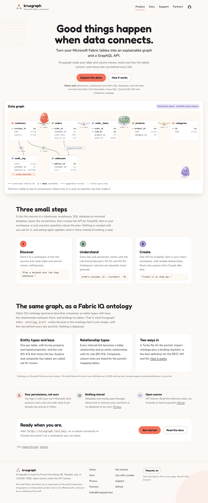

# fabric-backend — the engine behind Krusgraph

**Tables in Microsoft Fabric → an explainable graph and a GraphQL API for Claude, Lovable, Cursor and Claude
Code — and the Rayfin connector for Fabric Apps. One plan, both outputs, one call.**

Hosted as **[Krusgraph](https://krusgraph.com)** (`https://krusgraph.com/mcp`, sign-in with your Microsoft work
account, every call with your own Fabric permissions). The [demo](https://krusgraph.com/explore) runs the same
engine on a synthetic schema and needs no account. This repository is the whole thing: engine, MCP server, website
and deployment. Krusgraph is independent and not affiliated with Microsoft; "Microsoft Fabric" is used descriptively.



**The problem.** You have a lakehouse or warehouse in Fabric and you want an app on top of it —
in Lovable, or generated by an agent in Cursor or Claude Code. Those tools can read a Fabric
*API for GraphQL* item. They cannot make one. So before the first line of app code you spend an
afternoon in the portal: create the GraphQL item, pick tables, define every relationship by hand
(no relationships, no nested queries), register a service principal, grant it on the item, turn
on introspection, copy the endpoint. Then the schema changes and you do the relationships again.

Microsoft's own [GraphQL MCP server](https://learn.microsoft.com/fabric/data-engineering/api-graphql-local-model-context-protocol)
queries an API that already exists. Lovable's
[Fabric connector](https://docs.lovable.dev/integrations/microsoft-fabric) consumes one. As far as we have
found (October 2026), nothing provisions one from inferred relationships; if you know of something that does,
open an issue.

**What this does.** Reads the tables, infers keys and relationships from names (declared
constraints win when a warehouse has them), writes the GraphQLApi item definition with
ManyToOne / OneToMany relationships, creates the item — or updates it in place when the name
exists — and prints the endpoint plus the two portal clicks the API cannot do yet.

```python
%pip install git+https://github.com/Krusmaster/fabric-backend[deploy]
import fabric_backend as fb

out = fb.create(workspace="<workspace id>", source="my_lakehouse", name="shop_api", spark=spark,
                keys={"order_items": ["order_id", "line_no"]})   # optional here: rule K5 infers this one; `keys` overrides
print(out["plan"].summary())
print(out["card"])
```

```
7 tables, 6 with keys, 6 relationships
no key (query only; can reference others, cannot be referenced): audit_log
GraphQL endpoint:  https://api.fabric.microsoft.com/v1/workspaces/<ws>/graphqlapis/<id>/graphql
Still to do in the Fabric portal (no API for these yet):
  [ ] shop_api -> Settings -> Introspection -> On   (workspace admin; Lovable needs this)
  [ ] shop_api -> Manage permissions -> add the service principal with 'Run Queries and Mutations'
```

Paste the endpoint, tenant id, client id and secret into Lovable's Fabric connector. Done.

## Same thing from an agent (MCP)

```
pip install "fabric-backend[mcp]"
FABRIC_ODBC="Driver={ODBC Driver 18 for SQL Server};Server=<sql endpoint>;Database=<lakehouse>;Authentication=ActiveDirectoryInteractive" \
fabric-backend-mcp
```

The same engine over the one connection in `FABRIC_ODBC`: `list_tables`, `plan_backend` (keys, relationships,
Mermaid — nothing deployed), `validate_plan`, `sample_rows`, `create_backend`, `rayfin_connector`, `ontology_draft`,
`semantic_model_draft`, `join_path`, `data_dictionary`, `dbt_schema`, `analyze_schema`, `suggest_relationships` and
`create_views` (dry run by default). The tools that need Fabric item ids (`describe_backend`, `plan_drift`,
`app_starter`, `create_semantic_model`, `create_data_agent`) live in the remote server only. Set `FABRIC_SOURCE_KIND`
(`Lakehouse`, `Warehouse`, `SQLDatabase`) and `FABRIC_SCHEMAS_ENABLED=1` for a lakehouse created with schemas so that
`semantic_model_draft` writes `schemaName`; `SQLServer` for an on-prem or Azure SQL Server, where the two Fabric-only
drafts answer with an explanation. Windows set-up with Claude Desktop, Windows sign-in and what works locally:
[docs/LOCAL.md](docs/LOCAL.md). `fabric-backend demo` is the 20-minute demo on a laptop: one local page on 127.0.0.1
with the map, the health check with Accept / Skip and five questions run on the customer's own SQL Server or on a folder
of CSV / Excel files; script in [docs/DEMO-20-MIN.md](docs/DEMO-20-MIN.md). Add it to Lovable as a custom MCP connector, or to Claude Code / Cursor.
The agent can then say *"give me a GraphQL API over orders, customers and products"* and get an endpoint back.

## Remote server (Krusgraph: for Claude today, other MCP clients once their sign-in redirects are registered)

The hosted instance is `https://krusgraph.com/mcp`. Add it in Claude under Settings → Connectors → Add custom
connector and sign in with your Microsoft work account; your Entra admin consents once
(https://krusgraph.com/start has the steps, https://krusgraph.com/docs the details). To run your own:

```
docker build -t fabric-backend-server . && docker run -p 8000:8000 \
  -e FABRIC_TENANT_ID=... -e FABRIC_CLIENT_ID=... -e FABRIC_CLIENT_SECRET=... fabric-backend-server
```

Streamable HTTP at `/mcp`, twenty-five tools, every one with a `title` and a `readOnlyHint`/`destructiveHint`
(the directory requires it): `list_workspaces`, `list_sources`, `list_tables`, `plan_backend` (nothing deployed; suggests
composite keys), `sample_rows`, `validate_plan` (keys and relationships checked against the rows), `create_backend`
(creates or updates one item, never deletes), `describe_backend`, `query_graphql` (read-only; mutations refused),
`rayfin_connector` and `ontology_draft`; every tool takes the workspace by id or name. Five more read-only tools turn the
same plan into the week's deliverables, all unit-tested and run against the demo workspace (synthetic shop data) on 26 October 2026:

- `semantic_model_draft` — a Power BI semantic model in TMDL: Direct Lake tables on the SQL analytics endpoint,
  relationships with one active path per table pair, a `README.generated.md` with the decisions to check
  (`fabric_backend/semantic_model.py` cites the Microsoft sample definitions it follows).
- `join_path` — the shortest chain of relationships between two tables, rule per hop, ready T-SQL; or which
  relationship is missing.
- `data_dictionary` — hand-over documentation in Markdown with an empty Description column; `validate=true` adds counts.
- `dbt_schema` — a dbt sources file with `unique`, `not_null` and `relationships` tests (`fabric_backend/dbt.py` cites the dbt docs).
- `plan_drift` — today's plan against an existing API for GraphQL item: what a `create_backend` with that name would change.

Three more tools create things from the same plan, each `dry_run=true` by default so the first answer is exactly what
would be created, each creating or updating in place under a name and never deleting; all unit-tested with Fabric
mocked. On 26 October 2026 `create_views` ran for real on the demo lakehouse (schema and view created and read back); the two others answered `consent` (HTTP 403) because the app lacks the permission. The delegated permissions they need, against what the app has today, and
the `az` commands to add them are in [docs/SCOPES.md](docs/SCOPES.md):

- `create_semantic_model` — a SemanticModel item from the TMDL draft (`POST /semanticModels`, `updateDefinition`); needs
  `SemanticModel.ReadWrite.All` or `Item.ReadWrite.All` (not granted today).
- `create_views` — `CREATE OR ALTER VIEW` in a schema of its own (`krusgraph`) on the SQL analytics endpoint or
  warehouse: a wide view per fact table and one per hard-to-read relationship; needs no new scope, only the SQL right to
  create objects.
- `create_data_agent` — a Fabric data agent through the public staging API: the plan as instructions, the source as
  data source, 5–10 example questions with T-SQL, published; needs `Item.ReadWrite.All` (not granted today).
- `app_starter` (read-only) — a Lovable prompt, connection details, five GraphQL queries, the portal checklist and the
  backend an app needs so that no secret reaches the browser: a Supabase edge function that gets the token with the
  app's service principal and forwards the queries, the secrets as Supabase secrets, the frontend helper, and the
  per-user alternative (Supabase Auth with Entra, the user's own token forwarded). The backend part is unit-tested.
- `app_readiness` (read-only) — what an app still needs on an existing API: keyless types, unlinked types, write access
  from the definition, introspection from one probe query, and "unknown" with the click path for what Fabric's API
  cannot read (permissions, the tenant setting). Unit-tested. The whole Lovable chain, step by step with owners and
  blockers, is in [docs/LOVABLE-END-TO-END.md](docs/LOVABLE-END-TO-END.md).

Two read-only tools look at the plan as a graph (`fabric_backend/graphs.py`, pure Python, deterministic; unit-tested and
run against the demo workspace (synthetic shop data) on 26 October 2026):

- `analyze_schema` — table roles (fact, dimension, bridge, isolated) with the numbers behind them, the ten most central
  tables (degree, betweenness, PageRank), subject areas, cycles and table pairs with more than one path, and which
  relationships can be active at once in a semantic model (maximum spanning forest by certainty).
- `suggest_relationships` — columns that could point at another table's key but are in no relationship, ranked by name,
  type and triangular closure, the best fifteen checked against the data (inclusion share, distinct values); suggests only.
- `lineage` — which objects in the workspace build on the source's tables: GraphQL APIs (their definition), semantic
  models (their TMDL), views on the SQL endpoint (`INFORMATION_SCHEMA.VIEW_TABLE_USAGE`), data agents (named in their
  definition, marked as not certain); the objects per table, the tables used by nothing, and with `table` what a change
  reaches. `plan_drift` names the same objects for the tables and columns a re-run would drop (`impact`). Unit-tested
  with Fabric mocked, not yet run against a live workspace. A graph over several sources is a design note only:
  [docs/MULTI-SOURCE.md](docs/MULTI-SOURCE.md).

### How the graph is weighted

| Origin of a relationship | Certainty | Used for |
| --- | --- | --- |
| Declared foreign key (R0) or `confirmed` | 1.0 | |
| Any rule, when `validate_plan` found no orphans | 0.9 | safest `join_path`, active relationships in `semantic_model_draft` |
| R1 (column named after the table) | 0.8 | |
| R2 (column with the target key's name) | 0.6 | |
| R3 (composite key present), R4 (role prefix or abbreviation) | 0.5 | |

Cost is 1/certainty; the shortest path counts hops, the safest path minimises cost, and when they differ `join_path`
says why. Roles come from in/out degree, betweenness and the share of measure-like columns; subject areas from label
propagation with a fixed order; ambiguity from the relationships a spanning forest leaves out (each closes a cycle). The tool table with arguments
and an example question per tool is on https://krusgraph.com/docs. Authentication: a `Authorization: Bearer` Fabric
token on the request wins; otherwise the server's own service principal — the same model as
Lovable's Fabric connector. The server stores nothing. Put TLS in front, add it to Claude as a
custom connector with the `https://…/mcp` URL, and the loop is browse → plan → create → query.
The local stdio server (`fabric-backend-mcp`, ODBC string) stays for single-user use.

**Sign-in with Microsoft (how krusgraph.com runs).** Set `MCP_PUBLIC_URL`, `ENTRA_CLIENT_ID` and
`ENTRA_CLIENT_SECRET` and the server switches to per-user Entra sign-in: unauthenticated calls get the `401` with
a `resource_metadata` pointer that Claude needs, `/.well-known/oauth-protected-resource` describes the resource,
each user's token is validated (issuer per tenant, audience = the app, signature) and exchanged on-behalf-of for
Fabric and SQL tokens — every call runs with that user's own Fabric permissions. The delegated permissions the
Entra app asks for: `User.Read`, Fabric `Workspace.Read.All`, `Item.Read.All`, `GraphQLApi.ReadWrite.All`,
`GraphQLApi.Execute.All`, Azure SQL `user_impersonation`. Metadata and requested query results pass through the
server in memory only; there is no database. Agents outside Claude (Lovable's custom MCP connector, Cursor) need to
register themselves as OAuth clients, which Entra cannot do; `KRUSGRAPH_DCR=1` with `KRUSGRAPH_DCR_REDIRECTS` turns on a
registration facade that answers the Entra app's public client id for allowed redirect URIs and publishes RFC 8414
metadata pointing at Entra's endpoints, storing nothing ([docs/AUTH-DCR.md](docs/AUTH-DCR.md); off by default,
unit-tested, not yet tried with a real agent). The same process serves the website (`/`, `/explore`, `/start`,
`/support`, `/partners`, `/docs`, `/privacy`; static files under `fabric_backend/static/`, no external resources).
`PRODUCT_NAME`, `CONTACT_EMAIL` and the optional `COMPANY_ORGNR` fill the pages; `KRUSGRAPH_BUILD` (set by the deploy script to the image's source tag) is echoed on `/healthz` so a deploy can tell the new revision from the old one; `KRUSGRAPH_DEBUG_ERRORS=1` adds the exception class to tool error answers, for an operator debugging a case; `KRUSGRAPH_ONTOLOGY_WRITE` (deploy config `ontology_write`) is no longer read: `create_ontology` is always offered, dry run by default; `PARTNER_SIGNIN=1` shows a
not-yet-wired partner sign-in button. `deploy/` has the Azure Container Apps deployment (`krusgraph.sh`,
`--check`, `--update`, `--status`; exact image versions in `deploy/constraints.txt`; see `deploy/KRUSGRAPH-START.md`), the synthetic demo dataset
(`fabric_backend.seed`) and the directory submission draft (`deploy/SUBMISSION.md`). Tool failures come back
as `{"error", "kind", "hint"}` (`fabric_backend/errors.py`): an unknown workspace, a missing or paused
capacity, an expired sign-in or missing consent, a missing schema or table, a timeout, each in plain words and
never with a token, a header or a traceback.

## How the relationships are inferred

A lakehouse SQL endpoint has no keys and no foreign keys, so names are all there is. Every result
carries the rule that produced it, and you can overrule any of them.

| Rule | Keys | | Rule | Relationships |
| --- | --- | --- | --- | --- |
| K0 | declared primary key | | R0 | declared foreign key |
| K1 | `keys={"order_items": ["order_id", "line_no"]}` | | R1 | column `<table>_id` / `<singular>_id` → that table's single key |
| K2 | `id`, `<table>_id`, `<singular>_id`, `<table>_key`, `<table>_code`, or an abbreviation of four letters or more (`cust_key`) | | R2 | same name as another table's single key (`werks` → plant); plain `id` never matches |
| K3 | none → query only, nothing can point at it | | R3 | all columns of another table's composite key are present |
| K4 | junction: the table starts with two or more reference columns (`film_actor`: `actor_id` + `film_id`) | | R4 | weaker match when R1/R2 find nothing: a role before the name (`manager_staff_id` → staff) or an abbreviation (`o_custkey` → customer) |
| K5 | line: the header reference plus a line-number column (`order_items`: `order_id` + `line_no`) | | | |

Names are compared without case, separators or a table-wide column prefix (`N_NATIONKEY` in `NATION` reads as
`nationkey`), and `<X>Header` also answers to `<X>`. How well this works on Northwind, Chinook, TPC-H,
AdventureWorks and Sakila, from names alone, is measured in [docs/INFERENCE.md](docs/INFERENCE.md).

A column that could point at two tables (`user_id` with both `users` and `user` present) is
reported under `plan.ambiguous` and not applied. A column no rule matches (`ship_to_id` in the demo schema) is
simply left unlinked; `confirmed=[...]` is how you add it. Two columns pointing at the same table get fields
named by column (`airport_by_origin_airport_id`). Anything the rules miss goes in `confirmed=[...]`
and is applied first.

Dry run without deploying:

```python
p = fb.plan_from(spark=spark)          # or execute=<callable running SQL against the endpoint>
print(p.summary()); print(p.mermaid())
```

Offline, from an `INFORMATION_SCHEMA.COLUMNS` export:

```
fabric-backend plan columns.csv --keys keys.csv --mermaid er.mmd
fabric-backend definition columns.csv --name shop_api --workspace <ws> --source-item <sql endpoint id> --out def.json
fabric-backend deploy def.json --workspace <ws>
```

The consultant outputs from the same CSV, nothing created: `semantic-model` (TMDL folder, `--sql-endpoint`,
`--source-name`, `--source-kind`, `--schemas-enabled`), `join-path START END` (the chain with its T-SQL, exit 1 and a
suggestion when there is none), `dictionary` (Markdown), `dbt` (sources yml, `--legacy-arguments` for dbt before
1.10.5), `analyze` (roles, central tables, areas, ambiguity; `--json` for the full graph) and `views` (the
`CREATE OR ALTER VIEW` statements to run yourself, `GO` between the batches). `fabric-backend --help` lists them.

When a literal name finds nothing, a small documented synonym table is tried (abbreviations such as `cust`, `prod`, `ord`,
`emp`; Swedish and German business words; `dim_`/`fact_`/`tbl_` prefixes; `_sk`/`_bk` suffixes), after transliteration of
`å ä ö ü ß`. Such a match counts as R4, carries a `note` on the relationship and is listed under `plan.synonyms`. The
benchmark in `docs/INFERENCE.md` shows before and after on eleven schemas.

## Same plan, second output: Rayfin (Fabric Apps) connector entities

[Rayfin](https://www.microsoft.com/microsoft-fabric/features/rayfin) is Microsoft's open-source
backend SDK for apps on Fabric (Build 2026; Replit is the launch partner). It reaches existing
tables through *connectors*: `npx rayfin connector add` discovers the schema, and then
[every entity class is written by hand](https://learn.microsoft.com/fabric/apps/connectors) —
decorator per column, key per table, and no syntax for relationships between connector entities
in the docs. This writes them from the same plan:

```python
files = fb.rayfin_files(out["plan"], connector="shop")        # also in out["rayfin"] after fb.create
fb.write_rayfin(files, root="path/to/your/rayfin-app")        # rayfin/connectors/shop/*.ts + schema.ts
```

```typescript
// rayfin/connectors/shop/Orders.ts — generated
@role('authenticated', ['read'])
@entity()
// key order_id by rule K2  (by name — remove primaryKey if that is wrong)
export class Orders extends Source({ schema: 'dbo', table: 'orders', primaryKey: ['orderId'] }) {
  @int({ column: 'order_id' }) orderId!: number;
  @int({ column: 'customer_id' }) customerId!: number;
  @date({ column: 'order_date' }) orderDate!: string;

  @one(() => Customers, { sourceFields: ['customerId'], targetFields: ['customerId'] }) customer?: Customers;   // [R1]
  @many(() => OrderItems, { sourceFields: ['orderId'], targetFields: ['orderId'] }) orderItems?: OrderItems[];  // [R1]
}
```

Offline: `fabric-backend rayfin columns.csv --keys keys.csv --connector shop --out .`, or straight
from the `metadata.json` that `npx rayfin connector add` writes (`fabric-backend rayfin
rayfin/connectors/shop/metadata.json --schema shop ...`) — it has columns and types but no keys,
so inference still runs. The full output for the synthetic schema is in `examples/rayfin/`. From
an agent: the MCP tool `rayfin_connector`.

Two things the Rayfin docs do not say, learned from running it: `@one`/`@many` work on connector
entities **only with `sourceFields`/`targetFields`** — without them Rayfin invents a column
(`customer_customer_id`) and the query fails; and `@date()` properties are typed `Date`, not
`string`. Both are generated. The docs do say *don't infer a primary key from a column name*; this
does, and prints the rule beside every key so you can take it out.

## Sources it can expose

| Source | `sourceType` | Writes | Rayfin connector |
| --- | --- | --- | --- |
| Lakehouse | SqlAnalyticsEndpoint (the endpoint's id, resolved for you) | no | `fabric-sqlanalytics` |
| Mirrored database (Snowflake, Azure SQL, Cosmos DB, SAP via Datasphere, ...) | SqlAnalyticsEndpoint | no | `fabric-sqlanalytics` |
| Mirrored Azure Databricks catalog | SqlAnalyticsEndpoint (via the item's SQL analytics endpoint) | no | `fabric-sqlanalytics` |
| Snowflake database (Fabric item) | SqlAnalyticsEndpoint (via the item's SQL analytics endpoint) | no | `fabric-sqlanalytics` |
| Mirrored catalog (preview) | SqlAnalyticsEndpoint (via the item's SQL analytics endpoint) | no | `fabric-sqlanalytics` |
| Warehouse | Warehouse | `writable=True` → Create/Update (Delete stays off) | `fabric-warehouse` |
| Fabric SQL database | SqlDbNative | `writable=True` | `fabric-sqldatabase` |

**Fabric IQ.** `ontology_draft` (remote server), `fabric-backend ontology` (CLI) and `fabric_backend.ontology_files`
write the plan as a Fabric IQ ontology (preview): entity types with a key and properties, relationship types, data
bindings, in the item's generation-2 definition (TMDL parts for `POST /workspaces/{id}/ontologies` or Git) plus a
Turtle file for the portal's *Import ontology* and a binding checklist. Creating the item needs `Item.ReadWrite.All`;
`create_ontology` creates or updates the item from the same plan (dry run by default; without the permission it answers
`consent` naming the scope). Checked against recorded definitions and the specification's examples, not live yet.

**Snowflake and Databricks.** Two routes. (1) Bring it into Fabric (a Snowflake database item or a Mirrored database for
Snowflake, a Mirrored Azure Databricks catalog or a Mirrored catalog for Unity Catalog) and the item is a source like any other: the remote tools list it,
plan it and build the API for GraphQL item over its SQL analytics endpoint. (2) Plan directly: `plan_from(execute=...)`,
the CLI and the local stdio server read `INFORMATION_SCHEMA` the same way on Snowflake and Databricks as on Fabric
(Snowflake has no `KEY_COLUMN_USAGE`, so keys come from names there; Unity Catalog's informational constraints are
read as K0/R0). That route gives the explainable graph, the Mermaid diagram and the Rayfin entities; the API for
GraphQL item itself is a Fabric object, so route (2) ends at `dry_run`/`definition` unless the data is mirrored.
The item types, routes and `sqlEndpointProperties` follow Microsoft's published REST specification; a live run of these
source types is still pending.

For SAP tables the names say nothing (`VBELN`, `KUNNR`); use
[sap-ontology](https://github.com/Krusmaster/sap-ontology), which derives the graph from SAP's own
data dictionary and exports the same GraphQLApi definition — that is the SAP adapter for this.

## Two clicks remain

Introspection and item permissions are portal-only as far as we can tell (October 2026): the public docs list no
REST route for either, and the connection card says so instead of pretending. Tenant setting *"Service principals
can call Fabric public APIs"* is an admin task once per tenant. If you know a programmatic way for
either, open an issue.

## Status

Version history: [CHANGELOG.md](CHANGELOG.md).

**25 October 2026, evening: first end-to-end run of the hosted connector.** Claude → Entra (a work account in the
publisher's tenant) → Fabric (an F2 capacity, workspace `demo`, lakehouse `demo_lh`, schema `shop`, the synthetic
data from `fabric_backend/seed.py`). Every tool answered as documented: `list_tables` gave the 7 tables;
`plan_backend` gave 7 tables, 6 with a key, 6 relationships (all R1) and `audit_log` without a key;
`create_backend` created `shop_api` and a second run answered `mode: updated`; `query_graphql` followed three
relationship hops and returned 13 rows; a mutation was refused; an unknown workspace came back as `not_found`.
Work since that run (the ontology draft, Snowflake database items, mirrored catalogs) is covered by the test suite
with Fabric mocked and has not had a live run of its own yet.

**26 October 2026: the consultant, graph and dry-run tools against the same workspace.** From Claude through the
hosted connector, read-only or dry run, nothing created: `list_workspaces` and `list_sources` found the workspace and
`shop_api`; `validate_plan` answered 6 of 6 keys unique and 6 of 6 relationships without orphans; `semantic_model_draft`
and `create_semantic_model` (dry run) wrote the seven Direct Lake tables with `schemaName: shop` and six active
relationships; `join_path` gave the four-hop chain customers → categories with its T-SQL; `data_dictionary`
(`validate=true`), `dbt_schema`, `analyze_schema` (three fact tables, four dimensions, no cycles) and `create_views`
(dry run, one wide view) answered as the unit tests predict; `suggest_relationships` checked four candidates for
`orders.ship_to_id` against the data and only `addresses.address_id` held for every value; `plan_drift` on `shop_api`
reported the `ship_to_id → addresses` relationship the API carries and the plan does not infer, with the `confirmed`
entry to keep it; `describe_backend`, `app_starter` and `create_data_agent` (dry run) read and drafted from the live
items. Then with `dry_run=false`: `create_views` created schema `krusgraph` and `vw_order_items` on the lakehouse's SQL
analytics endpoint, and `list_tables` / `sample_rows` on that schema read the view back (16 columns, joined rows);
`create_semantic_model` and `create_data_agent` got HTTP 403 from Fabric and answered `kind: consent` naming the
permission to add, as [docs/SCOPES.md](docs/SCOPES.md) predicts. Not yet run: those two creates once the permissions
are granted, and the local stdio server against a real ODBC connection.

Earlier: v0.1.1 ran end to end in a Fabric sandbox on synthetic tables (2026-10-21): create, update in place, nested
queries across inferred relationships over four hops (customer → orders → lines → product → category). Findings and
the three fixes that came out of it are in [issue #1](https://github.com/Krusmaster/fabric-backend/issues/1): a
lakehouse's SQL endpoint shares its display name, a 202 create answers with an empty body, and any action left out
of the definition is stored as *Enabled* — so all five are now always spelled out. The Rayfin output went through
`npx rayfin up` in the same sandbox on 2026-10-22 ([issue #2](https://github.com/Krusmaster/fabric-backend/issues/2)):
deploy accepted, composite keys and `@date` columns work, the four-hop chain resolves through the connector's GraphQL
item. Reading through the Rayfin browser client was not tested (app auth needs `Item.Execute.All`). Lovable-side: the
endpoint is consumed by Lovable's standard Fabric connector; nothing Lovable-specific is generated.

## Development

```
pip install -e ".[server,test]" && pytest -q
PRODUCT_NAME=Krusgraph MCP_PUBLIC_URL=https://krusgraph.com/mcp ENTRA_CLIENT_ID=x ENTRA_CLIENT_SECRET=x fabric-backend-server
```

The website pages are templates in `fabric_backend/page_templates/`, the stylesheet and scripts in
`fabric_backend/static/` (fonts Fredoka and Nunito, SIL OFL, self-hosted). `/demo/plan.json` is `plan()` run on
`fabric_backend.seed.schema()`, so the demo shows what the engine says. `/mascots` is an unlinked, `noindex`
review page for the three figures. Screenshots used for the visual review are in `docs/screenshots/`.

For search engines and agents (`fabric_backend/discovery.py`, all public): `/sitemap.xml`, `/robots.txt`, `/llms.txt`
with Markdown versions of the pages (`/docs.md`, `/start.md`, `/privacy.md`, `/lovable.md`), an MCP Server Card at
`/mcp/server-card` and an AI Catalog at `/.well-known/ai-catalog.json`. The auth guard covers exactly `/mcp`.
`server.json` is the MCP Registry entry; publishing it is described in `docs/PUBLISHING.md` (not done).

## Works on

| | |
| --- | --- |
| Fabric notebook (Spark) | `spark=spark` |
| Anywhere with a SQL connection | `execute=` any callable, `fabric-backend create --odbc ...` |
| Local, offline | `plan` / `definition` from a CSV export |
| Python | 3.10+, no required dependencies; `requests` for deploy, `pyodbc` for SQL, `mcp` for the server |

## License

MIT
