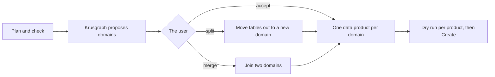
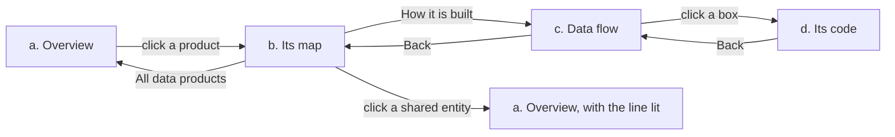

# Krusgraph and Fabric IQ at scale

Round n182 (section 8: round n186). A design note, docs only, nothing implemented here. Written 9 November 2026, ahead of a meeting with Microsoft on
11 or 13 November.

This is Krusgraph's own view. Every statement about Microsoft products rests on public sources cited here; anything
we could not check in a public source is marked Unverified. Our observation: Fabric IQ has many building blocks, and
assembling them is work. Fabric IQ gives the building blocks. Krusgraph builds them
for you from your tables and checks them against your rows.

How to read the status columns:

- **Verified** means a learn.microsoft.com page was opened on 9 November 2026 and says it. The link and the page's
  date (ms.date / last updated) are given.
- **Unverified** means no official page was found that says it. Treat it as an open question, not a fact.
- The Fabric blog (blog.fabric.microsoft.com) could not be opened from the session that wrote this. No blog post is
  cited as verified.

---

## 1. What Fabric offers today (research)

### 1.1 The ontology item

Key pages:

- Ontology definition, TMDL format ("generation 2"):
  https://learn.microsoft.com/en-us/rest/api/fabric/articles/item-management/definitions/ontology-definition
  (ms.date 2026-09-10, updated 2026-09-29)
- Ontology (old) definition, JSON format:
  https://learn.microsoft.com/en-us/rest/api/fabric/articles/item-management/definitions/ontology-old-definition
  (2026-08-19, updated 2026-09-29)
- REST operations: https://learn.microsoft.com/en-us/rest/api/fabric/ontology/items (updated 2026-09-23). Create,
  Get, List, Update, Delete, Get Definition (with `?format=`), Update Definition. The Get Definition page (updated
  2026-10-19) says "Ontology item is currently in Preview".
- Overview: https://learn.microsoft.com/en-us/fabric/iq/ontology/overview (2026-10-16)
- Rules: how-to-use-rules (2026-09-15), under learn.microsoft.com/en-us/fabric/iq/ontology/
- Graph from an ontology: how-to-use-ontology-graph (2026-09-18), same folder
- Ontology MCP server: how-to-use-ontology-mcp-server (2026-04-14, updated 2026-10-01), same folder

The definition parts in the TMDL format: `.platform`, `database.tmdl`, `model.tmdl`, `tables/*.tmdl` (Direct Lake
partitions and measures), `entities/{namespace}#{name}.tmdl`, `relationships.tmdl`, `entityRelationships.tmdl`,
`expressions.tmdl`, `namespaces/*.tmdl`, `rules/*.tmdl`.

| Building block | Status | Writable via REST / definition? | Source |
|---|---|---|---|
| Ontology item, Items API | Preview | Yes | Verified: ontology/items (2026-09-23) |
| Namespaces | Preview | Yes: `namespaces/*.tmdl`, references as `ns#name` | Verified: ontology-definition |
| Entity types | Preview | Yes: `entities/*.tmdl` | Verified: ontology-definition |
| Properties | Preview | Yes: string, int64, double, dateTime, boolean, decimal, Any, `TimeSeries<T>` | Verified: ontology-definition |
| Complex types | Preview | Yes: `complex` (struct, timeSeries; no array kind) | Verified: ontology-definition |
| Entity keys | Preview | Yes: `keyProperty`. Keyless entity types are allowed. | Verified: ontology-definition, overview |
| Relationships | Preview | Yes: `entityRelationships.tmdl`, backed by a table relationship or a junction table | Verified: ontology-definition |
| Binding to lakehouse tables | Preview | Yes: backing tables with a Direct Lake partition | Verified: ontology-definition |
| Binding to eventhouse | Preview | Old JSON format only (`KustoTable`, time series). Not shown in the TMDL format. | Verified: old definition; overview lists eventhouse as a source |
| Metrics | Preview | Partly. `explicit` metrics (KQL, SQL, generic, natural language) yes. Metrics projected from semantic-model DAX measures: no. | Verified: ontology-definition |
| Taxonomy and metadata | Preview | Descriptions (`///`), `synonym`, `annotation`, `resourceLink`: yes. A separate "taxonomy" object: not documented. | Verified for the four; taxonomy Unverified |
| Rules | Preview | Yes: `rules/*.tmdl`, natural-language statements. Not executed. | Verified: how-to-use-rules |
| Actions | Not documented | No. The rules page says the ontology does not execute actions. Activator alerts were in the old experience only. | Verified: how-to-use-rules |
| Inheritance | Preview, rolling out | Yes: `baseEntityType` (cannot change later), `redefines`, `reusableProperty` | Verified: ontology-definition |
| Versioning | Preview | Named version history in the portal. No API found. | Verified (portal): overview. API: Unverified |
| Health | Unknown | No page found | Unverified |
| Graph from the ontology | Preview | Portal only ("Manage graph"). Makes a separate graph model item. Needs a key on every entity; lakehouse or mirrored Delta sources only. | Verified: how-to-use-ontology-graph |
| Ontology MCP endpoint | Preview | `https://api.fabric.microsoft.com/v1/mcp/dataPlane/workspaces/{ws}/items/{id}/ontologyEndpoint`. Service principals not supported yet (known issue). | Verified: how-to-use-ontology-mcp-server |
| Old JSON format retires | Dated | The old experience retires 31 January 2027 | Verified: old definition page |

Overall status:

- The IQ workload is labelled "IQ (preview)", and the ontology is preview. No Learn page says it is GA.
  Verified: https://learn.microsoft.com/en-us/fabric/iq/overview (2026-07-08).
- Fabric IQ in Microsoft 365 Copilot Chat is GA, but it answers from Power BI reports and semantic models.
  Ontologies and data agents need a published Microsoft 365 agent. Verified:
  https://learn.microsoft.com/en-us/fabric/iq/connectors/microsoft-365-copilot-overview (2026-09-15).
- The public preview announcement at Ignite 2025 (Fabric blog, "From data platform to intelligence platform:
  introducing Microsoft Fabric IQ"): Unverified, blog not reachable.
- Fabric IQ as a plugin in Copilot Cowork: no Learn page found. Unverified.

### 1.2 Graph and data agent

| Feature | Status | Via REST / definition? | Source |
|---|---|---|---|
| Graph model item | Unclear: the graph overview has no preview banner, the IQ overview calls it preview | Yes: create, get and update definition (`dataSources`, `graphDefinition`, `graphType`, `stylingConfiguration`). Execute Query is beta. | Verified: rest/api/fabric/graphmodel/items (2026-02-04); graph-model-definition (2026-07-01) |
| Fabric data agent | GA | Yes: definition parts under `Files/Config/...`, and the staging API | Verified: fabric/data-science/concept-data-agent (2026-10-21); data-agent-definition (2026-02-11) |
| Data agent with an ontology as source | Preview | Portal: yes. The definition's datasource type list has no ontology value. | Verified: data-agent-add-datasources (2026-08-31). Via API: Unverified |

### 1.3 Semantic model features that ground Copilot

| Feature | Status | Via REST / definition? | Source |
|---|---|---|---|
| Descriptions on tables, columns, measures | GA | Yes: `///` lines in `definition/*.tmdl` | Verified: analysis-services/tmdl/tmdl-overview (2026-06-11); semantic-model-definition (2026-03-18) |
| Synonyms (linguistic schema) | GA, Q&A going away | Yes: `cultures/*.tmdl` with linguistic metadata | Verified: tmdl-overview |
| Power BI Q&A | Deprecated | Learn: "Q&A experiences are going away in February 2027" | Verified: power-bi/natural-language/q-and-a-intro (2026-09-10). A December 2026 date seen elsewhere: Unverified |
| Prep data for AI (AI schema, verified answers, AI instructions) | Preview | Stored with the model. The definition page's sample tree shows a `Copilot/` folder (`Instructions/instructions.md`, `VerifiedAnswers/`, `schema.json`, `examplePrompts.json`, `settings.json`), but its parts table does not list it. Changes deployed by Git need a refresh. "Approved for Copilot" is a portal setting. | Verified: power-bi/create-reports/copilot-prepare-data-ai (2026-09-16). Writing the folder via REST: Unverified |
| Endorsement (promoted, certified, master data) | GA | No public API to set it was found | Verified (portal): fundamentals/endorsement-promote-certify (2026-02-17). API: Unverified |
| Domains | GA | Yes: admin API (create domain, assign workspaces, roles) | Verified: rest/api/fabric/admin/domains (2025-09-17) |
| Tags | GA | Yes: apply, unapply, list | Verified: rest/api/fabric/core/tags (2025-07-23) |
| OneLake catalog search | Preview | Yes: `POST /v1/catalog/search`, filters on type and workspace only | Verified: rest/api/fabric/core/catalog/search (2026-11-06) |
| Item description | GA | Yes: Update Item, 256 characters | Verified in specs, see `fabric_backend/catalog.py` header |

Definition pages for the other items Krusgraph writes all exist: Lakehouse (2026-03-30), Report (PBIR, 2026-03-18),
GraphQLApi (2025-05-14), DataAgent (2026-02-11), Notebook (2025-07-02), under
learn.microsoft.com/en-us/rest/api/fabric/articles/item-management/definitions/.

What this means for us:

1. Most ontology building blocks **are** writable through the definition, in preview. Namespaces, inheritance,
   synonyms, rules and descriptions can be generated.
2. Versioning, health, graph creation from an ontology, endorsement and "Approved for Copilot" are portal-only or
   undocumented. We should not build on them yet. We ask Microsoft (section 7).
3. Actions are not an ontology feature today. Rules are text.

---

## 2. Each building block against the Krusgraph engine today

Code read on 9 November 2026 at `a6b4c2a`.

| Building block | Krusgraph today | Status | Where |
|---|---|---|---|
| Entity types | One per keyed table, named from the table | Done | `fabric_backend/ontology.py` (`ontology_parts`, `entity_name`) |
| Properties and types | Column types mapped to ontology types; `decimal(p,s)` binds as string | Done | `ontology.py` `_TYPES`, `prop_type` |
| Keys | Inferred (rules K0-K5), checked against rows for uniqueness and empty values | Done | `infer.py`; `evidence.py` `validate` |
| Relationships | Inferred (rules R0-R5), each checked against the rows for orphans | Done | `infer.py`; `evidence.py` `validate`; `ontology.py` `entityRelationships.tmdl` |
| Data bindings | Direct Lake binding to the source lakehouse; a binding checklist for the portal route | Done | `ontology.py` `ontology_parts`, `bindings` |
| Create and update the item | `ontology_draft` (read only), `create_ontology` (dry run by default, updates in place). Created live on 28 October 2026. | Done | `server.py:876`, `server.py:916`; `deploy.py:359`; `tool_status.py` |
| Namespaces | One namespace, `default`, per ontology | Partial | `ontology.py:157`, `:178` |
| Descriptions | Every entity and relationship carries the rule that found it | Partial (rule text, not business meaning) | `ontology.py:204`, `:222` |
| Synonyms | Used inside inference to match names; not written to the ontology or the model | Missing | `infer.py` `_synonym_words` |
| Metrics | Sum and count measures in the semantic model, with the reason; none in the ontology | Partial | `semantic_model.py` (measures), `amounts.py`, `level_measures.py` |
| Rules | None written | Missing | n/a |
| Actions | n/a (not a Fabric feature today) | n/a | n/a |
| Inheritance, complex types | None | Missing | n/a |
| Versioning | Our side: the review file and outputs are versioned, nightly plan snapshots are saved. Fabric's version history: not used. | Partial | `workload/.../ModelItemDefinition.ts`; `monitor.py` `snapshot`, `save` |
| Health | Row check (keys, links); nightly drift monitor that reports schema changes and what they reach | Partial (not shown as ontology health) | `evidence.py`; `monitor.py`; `server.py:2032`, `:2048`; `server.py:1283` `plan_drift` |
| Semantic model | Direct Lake TMDL from the plan, relationships with cardinality, date table, measures. Created live on 29 October 2026. | Done | `semantic_model.py`; `server.py:967`, `:1471` |
| Model descriptions | On measures and the date table only; not on tables or columns | Partial | `semantic_model.py:244`, `:452` |
| Linguistic schema / prep data for AI | Not written | Missing | n/a |
| Data agent instructions | AI instructions, data source instructions and example questions from the plan | Done (no recorded live run) | `data_agent.py`; `server.py:1687` |
| Domains, data products | Proposed domains from the graph, each with an ODCS v3.2.0 contract | Partial (draft; no Fabric domain is created) | `domains.py` |
| OneLake catalog | Item descriptions and tags drafted with the exact REST calls; not sent | Partial | `catalog.py`; `server.py` `export_item_definitions` with `items=["catalog"]` |
| Several sources in one plan | One source and one schema per plan; shortcuts into one lakehouse work today | Missing (design note exists) | `docs/MULTI-SOURCE.md` |
| Model item as manifest | `review.json`, `source.json`, `outputs.json` (outputs, created ids, data product), `item.json` | Partial (no owner, no contract) | `workload/Workload/app/items/ModelItem/ModelItemDefinition.ts`; `workload_api.py` |
| Cleanup | Tools never delete. The Model item updates only items whose ids it recorded as created. | Missing | `server.py:916` docstring; `workload_api.py` header |

One thing to check, not a known bug: the Learn page names entity parts `entities/{namespace}#{name}.tmdl`. Krusgraph
writes `entities/{name}.tmdl`. The live create on 28 October worked. We should run a Get Definition on that item and
compare before we add namespaces.

### Gaps to fix in a later round

| Gap | What happens today | Fix | Effort |
|---|---|---|---|
| `create_ontology` overwrites by name | The MCP tool updates any ontology with the given name in place, including one Krusgraph did not create. An update replaces the whole definition, so entity types not in the plan leave it (`server.py:916` docstring). The Model item does not have this problem: it skips items it did not build (`workload_api.py`). | Before an update, check that the item was made by Krusgraph (its description or a recorded id), otherwise refuse with a clear error unless the caller says to replace it. The same check for the other creating tools that update by name. | S |

---

## 3. Scale design

The idea: a team does not want one ontology. It wants one per data product, and a shared core across them. Krusgraph
proposes each piece from checked data, shows it as a diff, and builds it on Create.

### 3.1 Four common ontology cases (our framing)

| Case | How Krusgraph helps today | What is missing |
|---|---|---|
| **(a) Connecting data across systems** (customer in CRM, orders in ERP, deliveries in a warehouse) | One source at a time: keys and links checked against rows. Across sources: only when they are shortcuts in one lakehouse. | Plans across several lakehouses, shared keys checked across them, shared entities proposed. **This is where the row check matters most.** |
| (b) Modelling real-world operations (machines, lines, sensors, maintenance) | Entities and links from tables in a lakehouse | Eventhouse and time-series bindings; complex types |
| (c) Consistent meaning (Revenue, Customer, Product defined once) | Measures with a reason; amount level checks (a header amount is not summed per line) | Measures as ontology metrics; descriptions and synonyms in business words; one definition shared by model and ontology |
| (d) Operational apps and AI (a delayed shipment belongs to an order and a customer) | GraphQL API, data agent, app (Rayfin, n181), all from the same checked links | Ontology as data agent source via API (not documented) |

**Lead case (a).** A name match across systems is a guess. `customer_id` in a CRM and `KUNNR` in an ERP may or may
not be the same customer. An ontology that links them without a check gives Copilot confident wrong answers.
Krusgraph would:

1. Plan each source as today.
2. Propose cross-source links from shared keys (same type, name rules, the SAP and Salesforce packs).
3. Count the overlap on the rows: how many CRM customers exist in the ERP and the other way round. Show the share.
4. Propose a shared entity (`Customer`) in a shared namespace only when the overlap passes. Otherwise propose two
   entities and a link, or nothing, and say why.
5. Show it as a diff for review, then build.

### 3.2 The pieces

| # | Piece | What it means | Needs from Fabric | API status | Effort | Order |
|---|---|---|---|---|---|---|
| 1 | Namespace per domain or data product | Each data product writes its own namespace; shared entities live in a `core` namespace | `namespaces/*.tmdl`, `ns#name` references | Verified (preview) | S | 1 |
| 2 | Model item as manifest | Add `owner`, `version` and the ODCS `contract` (from `domains.py`) to `outputs.json`, next to sources, checked links and created ids | Nothing new (our item definition) | n/a | S | 2 |
| 3 | Descriptions, synonyms, metrics for Copilot | Business descriptions on tables, columns and entities; synonyms from name rules and packs; measures with a description; data agent instructions already exist | TMDL `///`, `cultures/*.tmdl`, ontology `synonym`; `Copilot/` folder | Descriptions and synonyms Verified; `Copilot/` folder via REST Unverified | M | 3 |
| 4 | Health from the row check and drift | One health line per data product: keys and links passed, failed, not checked; schema changes since last night and what they reach | Nothing (our own check and monitor). A Fabric health surface: none found. | Health in Fabric Unverified | M | 4 |
| 5 | Versioning when the schema changes | The drift monitor finds a change; Krusgraph proposes the new definition as a diff; on accept it bumps the manifest version and calls Update Definition | Update Definition | Verified. Fabric's named versions: portal only | M | 5 |
| 6 | Ontologies across several lakehouses (case a) | Plans per source, cross-source links checked on rows, shared entities proposed, reviewed as a diff | Bindings to tables in several lakehouses in one ontology | Bindings Verified; multi-source binding in one item: confirm with Microsoft | L | 6 |
| 7 | Cleanup and rebuild | Delete only items whose ids are in `outputs.json`'s created list, after a dry run that lists them; rebuild from the plan | Items Delete per type | Verified (ontology Delete); per other type: check specs | M | 7 |
| 8 | Inheritance and complex types | Propose a base type when tables share a key and most columns (e.g. `Party` for customer and supplier) | `baseEntityType`, `complex` | Verified (rolling out) | M | later |
| 9 | Rules | Write each checked key and link as a natural-language rule ("every order has a customer: 99.8% of rows checked") | `rules/*.tmdl` | Verified (text only) | S | later |
| 10 | Domains and tags in Fabric | Send the catalog draft: tags and descriptions; domains only for admins | Tags apply, Update Item, admin domains | Verified | S | after 3 |

Not planned: actions (not a Fabric feature), endorsement (no API found, and a human decision), graph creation from
the ontology (portal only).

---

## 4. Positioning

**One sentence:** Fabric IQ gives you the building blocks; Krusgraph builds them for you from your tables, checked
against your rows.

**Line to test:** "One checked plan, every starting point."

Three proof points that are true today:

1. Every key and link carries the rule that found it, and can be counted against the rows before anything is built
   (`infer.py`, `evidence.py`).
2. The same plan becomes a semantic model, a report, an ontology, an API for GraphQL, a data agent, silver and gold
   notebooks and a pipeline, consistent with each other (`workload_api.py` `KINDS`).
3. Nothing changes in Fabric until Create: every creating tool is a dry run by default, and the Model item never
   writes over an item of the same name that it did not build (`workload_api.py`).

Common needs, the Fabric item we see as the natural starting point for each, and what Krusgraph builds from one plan:

| Need | Starting point in Fabric | Krusgraph builds it today? |
|---|---|---|
| Store, transform, process data | Lakehouse or warehouse | Yes: silver and gold notebooks, pipeline, views |
| Power BI reports, trusted KPIs | Semantic model | Yes: semantic model and a report |
| Shared entities and relationships for AI agents | Ontology | Yes, one source per ontology (preview item) |
| Relationship paths, dependencies, impact | Graph, optionally from an ontology | Partly: our own path finding (`join_path`); Fabric's graph is made from the ontology in the portal |
| Natural-language questions over a domain | Data agent, with ontology when useful | Yes: data agent over the source; ontology as its source not via API |
| Apps on the data | API for GraphQL, App (preview) | API for GraphQL today; app (Rayfin, preview) in n181 |
| Budgets and forecasts | Fabric Planning | Out of scope |

Today vs direction:

| Today | Direction |
|---|---|
| One source and schema per plan | Several lakehouses, shared entities from checked shared keys |
| One `default` namespace | A namespace per data product, a shared core |
| Descriptions name the rule | Business descriptions and synonyms for Copilot |
| Measures in the semantic model | The same metrics in the ontology |
| Row check and nightly drift report | A health line per data product, a proposed new version on schema change |
| Creates and updates, never deletes | Cleanup and rebuild of what Krusgraph made |
| Domain proposals and ODCS contracts as drafts | Owner, version and contract in the Model item |

We make no claims about speed, compliance or endorsement. Microsoft does not endorse or partner with Krusgraph.

---

## 5. Krusgraph and Foundry IQ

Foundry IQ puts knowledge sources (indexed ones such as OneLake and remote ones such as a Fabric ontology or an MCP
server) behind a knowledge base. A Foundry agent or a custom agent reaches the knowledge base through the Retrieve API
or its MCP endpoint (sources below). An example of the kind of question this serves: a technician asks about a part,
and the answer combines parts and inventory data (an ontology) with procedures and rules (documents).

### What Learn says (read 9 November 2026)

| Fact | Status | Source |
|---|---|---|
| Knowledge source kinds: search index, Azure blob, OneLake (GA); Azure SQL, file, indexed SharePoint (preview, indexed); remote SharePoint, Fabric data agent, Fabric ontology, MCP server, Work IQ (preview, remote); web (GA, remote) | Mixed | Verified: https://learn.microsoft.com/en-us/azure/search/agentic-knowledge-source-overview (2026-09-01, updated 2026-09-17) |
| Fabric ontology knowledge source: kind `fabricOntology`, takes `workspaceId` and `ontologyId`. Auth is on-behalf-of: the end user's token, scoped to `https://search.azure.com/.default`, goes in the `x-ms-query-source-authorization` header. Search service and Fabric in the same tenant. | Preview | Verified: https://learn.microsoft.com/en-us/azure/search/agentic-knowledge-source-how-to-fabric-ontology (2026-06-02) |
| MCP server knowledge source: kind `mcpServer`. "The server must be reachable from Azure AI Search over HTTPS." You list the allowed tools by name; the knowledge base's model picks which to call and writes the arguments. | Preview (`2026-08-01-preview`) | Verified: https://learn.microsoft.com/en-us/azure/search/agentic-knowledge-source-how-to-mcp-server (2026-08-17) |
| MCP server auth: `foundryConnection` (only when a Foundry Agent Service agent calls the knowledge base) or `storedHeaders` (static headers, "for static, long-lived credentials, such as API keys", "not intended for per-user credentials or rotating tokens"). Headers can also be passed per retrieve request. | Preview | Verified: same page |
| MCP server auth with Entra on-behalf-of, managed identity or OAuth | Not documented for `mcpServer` | Unverified |
| MCP transport (streamable HTTP or SSE) | Not stated | Unverified |
| How a Foundry agent connects: the knowledge base's MCP endpoint `{search}/knowledgebases/{name}/mcp`, one tool `knowledge_base_retrieve`, a `RemoteTool` project connection with the project's managed identity | Preview | Verified: https://learn.microsoft.com/en-us/azure/foundry/agents/how-to/foundry-iq-connect (updated 2026-10-23) |

### Two paths

**1. Indirect: the ontology Krusgraph builds is the Fabric IQ source.** Works with what exists today. `create_ontology`
makes the ontology item; a Foundry IQ knowledge base adds it as a `fabricOntology` source. The answer then rests on
keys and links that were checked against the rows. Nothing to build on our side. The user's own token flows through
(OBO), so Fabric's permissions apply. Effort: none (a how-to page, S).

**2. Direct: Krusgraph's read-only tools as an MCP knowledge source.** An agent asks "how does a work order connect to
a part?" and the knowledge base calls `join_path`, `data_dictionary`, `lineage`, `plan_backend` or `validate_plan`.
These are the tables' structure and the checks, not row content.

What we would need:

| Need | Today | Gap | Effort |
|---|---|---|---|
| A read-only endpoint with no Create tools | `KRUSGRAPH_READ_ONLY=1` removes every creating tool (`fabric_backend/switches.py`); `KRUSGRAPH_NO_ROW_VALUES=1` removes `sample_rows` and row values | Run it as a separate hosted endpoint | S |
| Auth Foundry supports | Our hosted server takes the user's Entra token and exchanges it on-behalf-of the user for Fabric and SQL (`fabric_backend/entra.py` `OnBehalfOf`) | `mcpServer` documents only static headers or a Foundry connection. A static API key carries no user, so the tools could not read the lakehouse as the user. Options: a per-request header with the user's token (documented as possible, untested), or a per-tenant key tied to a workspace identity with read access (new, needs care) | M to L |
| Tool choice by the knowledge base's model | Our tool descriptions are written for agents | Allow only a small list (`join_path`, `data_dictionary`, `lineage`); check that answers stay short | S |

Recommendation: lead with path 1 now. Ask Microsoft about auth before building path 2.

---

## 6. Data products: where Krusgraph fits

Krusgraph's view, based on the public pages cited below.

### Fabric gives the governance foundation

| Fabric feature | What it does | Source |
|---|---|---|
| OneLake catalog | Explore, Govern and Secure experiences: find items, see governance status and recommended actions | Verified: https://learn.microsoft.com/en-us/fabric/governance/onelake-catalog-overview (2026-08-26) |
| Domains and subdomains | Group workspaces by business area; subdomains managed by the parent domain's admins | Verified: https://learn.microsoft.com/en-us/fabric/governance/domains (2025-05-01, updated 2026-09-29) |
| Endorsement | Promoted, certified, master data (portal; no set API found) | Verified: section 1.3 |
| Sensitivity labels | Labels and policies from Microsoft Purview Information Protection on Fabric items | Verified: https://learn.microsoft.com/en-us/fabric/governance/information-protection (2026-07-13) |
| Purview with Fabric | Information protection, DLP, audit, insider risk, governance of Copilot and agents | Verified: https://learn.microsoft.com/en-us/fabric/governance/microsoft-purview-fabric (2026-08-26) |
| Purview Unified Catalog data products | "A group of data assets, such as tables, files, and Power BI reports, with a defined use case", with owners, in one governance domain, accessed through an access policy | Verified: https://learn.microsoft.com/en-us/purview/unified-catalog-data-products (2024-04-08, updated 2025-11-18) |
| Lineage view | Items in one workspace and their connections; impact analysis for other workspaces | Verified: https://learn.microsoft.com/en-us/fabric/governance/lineage (updated 2026-06-04) |
| Public Fabric roadmap (roadmap.fabric.microsoft.com) | Could not be opened from this session | Unverified |

### Krusgraph builds the data product on top

The Krusgraph Model item is the data product's manifest: its sources, the checked keys and links, the outputs with
their ids, and (to add, section 3.2 piece 2) owner, version and contract. From one checked plan it builds the semantic
model, ontology, data agent, API and app. Fabric's catalog, domains, labels and Purview then govern those items as
they govern any other.

### What Krusgraph can add now, next to governance

| Addition | What it gives | Today | Where |
|---|---|---|---|
| Descriptions and synonyms | Glossary-like terms on the model and the ontology, so Copilot and people read the same meaning | Partial: rule text on entities and links, descriptions on measures; synonyms not written yet | `ontology.py`, `semantic_model.py`; section 3.2 piece 3 |
| Lineage from the plan | Which objects build on which tables and columns, read from the workspace | Done (read only) | `lineage` tool, `server.py:2512` |
| A health signal | Keys and links passed, failed or not checked; schema changes since last night and what they reach | Partial (not one health line yet) | `evidence.py`, `monitor.py`; section 3.2 piece 4 |
| KPI and OKR style views | An App over the checked plan with key figures, list pages and charts | Preview (n181) | `rayfin.py`, `rayfin_app.py`, docs/RAYFIN-APP.md |
| Catalog descriptions and tags | What Krusgraph knows, written as item descriptions and tags | Draft only, calls not sent | `catalog.py` |

### Design principle

Align with Fabric's catalog, domains and access flows. Do not build a parallel governance layer. Krusgraph writes into
what Fabric offers: item descriptions, tags, domains, the semantic model and ontology definitions. When Fabric adds a
native place for something Krusgraph keeps today (a contract, an owner, a health status, a version), Krusgraph writes
into it instead of competing with it.

---

## 7. For the Microsoft meeting

**The story in five bullets**

- Fabric IQ has the right building blocks. Customers find them complex to assemble.
- Krusgraph reads the tables, proposes keys and links with the rule behind each, and counts them against the rows.
- One reviewed plan becomes the semantic model, report, ontology, data agent, GraphQL API and app, consistent with
  each other.
- Everything is a dry run until Create, inside the customer's Fabric, as the signed-in user.
- Next: ontologies across several sources, where checking shared keys on the rows matters most.

**Demo path** (synthetic shop data)

1. Plan: open the Krusgraph Model item, pick the lakehouse; keys and links appear with their rules.
2. Check: count every key and link on the rows; show one that fails and why.
3. Dry run: pick outputs (model, report, ontology, data agent); show what would be created.
4. Create: build them; open the ontology and the report in Fabric.

**Questions to ask Microsoft**

1. Which ontology features are writable via the definition API, and which will stay portal-only (graph from
   ontology, named versions, data agent with an ontology source)? Is the `entities/{ns}#{name}.tmdl` naming required?
2. What is the roadmap for namespaces across items, versioning and a health signal for ontologies? Is there an API
   planned for version history?
3. Can a partner workload item (the Krusgraph Model) publish to or sit behind the Fabric IQ MCP endpoint, and when
   will service principals work there?
4. How does Copilot's grounding choose between a semantic model's prep-for-AI settings and an ontology over the same
   tables? Is writing the `Copilot/` folder through the semantic model definition supported?
5. What does a Workload Hub listing need for a workload that creates IQ items, and is there a preview path for
   partners?
6. For an MCP server knowledge source in Foundry IQ, which auth is planned beyond static headers and a Foundry
   connection: will an end user's token (on-behalf-of) be passed to the MCP server, as it is for the Fabric ontology
   source?
7. How do you want partners to build data products so they fit with Purview and the OneLake catalog: which item
   metadata, domains and access flows should a partner workload write to?

---

## 8. Data products: packaging, overview and the guide in Fabric

Round n186. A design text, docs only, nothing implemented here. Written 10 November 2026. It builds on section 3.2
(the pieces) and section 6 (where Krusgraph fits). Every statement about Microsoft products rests on the public Learn
pages already cited in section 6, or is marked Unverified.

**Where we are.** From one checked plan the Krusgraph Model item creates silver and gold, a pipeline, a semantic model
(refreshed once), a report, an API for GraphQL, an ontology, a data agent and an App (Rayfin, preview). For each output
it keeps the plan id and the schema fingerprint in `outputs.json` (`workload_api.py`, `plan_mark()` and `created[].plan`).
Its dry run already proposes domains: on the shop, `customers` (addresses, customers, order_items, orders) and
`products` (categories, products). The engine already writes one ODCS v3.2.0 contract per domain (`domains.py`,
`contract()` and `draft()`), and it already knows the links between domains (`interfaces`, with a consumer and a
provider). What is missing is the step that turns a proposed domain into a data product the user owns.

How to read the tables: **Today** names the file that does it now. **New** is work for a later round. Effort is S (a
day or less), M (a few days), L (a week or more).

### 8.1 Packaging

#### What one data product is

| Part | What it holds | Today | New |
|---|---|---|---|
| Name | The domain's name, editable | `domains.py` names it; `_product()` in `workload_api.py` keeps a product name | The name comes from the accepted domain, not typed separately |
| Owner | A person or group in Entra | `_product()` writes `owner: null` and "Nobody has chosen an owner yet." | A people picker; written to `outputs.json` and to the contract's team block |
| Source tables | The tables in the domain | `domains.py` `propose()` | Kept per product in `outputs.json` |
| Checked links | Keys and links inside the product, with their row check | `review.json` in the item, `validate_plan` | Filtered to the product's tables |
| Interfaces | Links to other products (consumer, provider) | `domains.py` `interfaces` | Kept per product; drawn in the overview |
| Outputs with ids | What Create made, with plan id and schema fingerprint | `outputs.json` `created[]` (n180) | Nothing new |
| Contract | ODCS v3.2.0 YAML | `domains.py` `contract()`, status `draft`, version `0.1.0` | Kept in the item definition (a `contract.yaml` part); status moves to `active` when the owner accepts it |
| Version | One number for the product | The contract's `0.1.0`; the review's own version | Bumped on an accepted change (section 3.2 piece 5) |
| Health | Row check and drift | `evidence.py` (row check), `monitor.py` and `create_drift_monitor` (drift, an MCP tool, not an item output yet) | One health line per product: green, amber, red (8.2) |

Health rules, kept simple:

- **Green**: every key and link passed on the rows, and no schema change since the last Create.
- **Amber**: something is not checked, or the schema changed in a way that breaks nothing built.
- **Red**: a key or link failed, or a schema change breaks a built output (a removed or retyped column a model,
  view or API uses; `monitor.py` `affected()`).

#### The flow



Split and merge are moves of tables between domains, nothing else. Two rules stay fixed: a table that is part of
another table's aggregate (order_items with orders) moves with it, as `propose()` already decides; and a table with no
domain stays in the "unassigned" list until the user places it. Every move shows, before it is kept, which links become
interfaces and which interfaces become inner links.

#### The ontology

- **One namespace per data product.** `ontology.py` already writes a namespace (`namespaces/{namespace}.tmdl`, today
  `default`). The product's slug becomes the namespace: `customers`, `products`. Namespaces and `ns#name` references
  inside one ontology item: Verified (preview), section 3.2 piece 1.
- **A shared entity is defined once.** Example: `Customer` is used by `customers` and by a later `support` product.
  The product that holds the table (the provider in `interfaces`) owns the entity. Others reference it.
- **How a reference is written in Fabric.** A reference across ontology items: Unverified (no Learn page found; a
  question for Microsoft, section 7). Until it is confirmed, Krusgraph writes the shared entity into the consumer's
  ontology as a bound copy, with the description "Defined in customers. Edit it there." On each Create, Krusgraph
  checks that the copy still equals the owner's definition and says so if not. In Krusgraph's own views it is shown
  once, with a line to each product that uses it.

#### The Fabric shape: one item per data product

Recommendation: **one Krusgraph Model item per data product.** Reasons:

1. `outputs.json` already means "the items this Model built and may update". One product per item keeps that promise
   simple: Create and a later cleanup (section 3.2 piece 7) never touch another product's items.
2. Access in Fabric is per workspace and per item. A product's owner can share its item without sharing others.
3. Domains group workspaces (Verified: the domains page in section 6). A product can sit in the workspace of its
   domain only if it is its own item. Assigning a single item to a domain: Unverified.
4. The OneLake catalog lists items (Verified, section 6). One item per product shows each product as a findable thing,
   with its owner and description.
5. Version, health and a failed Create stay local. A red product does not make another one red.

The cost: shared entities and the overview need to read more than one item. The overview (8.2) reads every Krusgraph
Model item the user can open in the chosen workspaces, through their item definitions. No new item type is needed.

How the split happens in the item: after the user accepts the domains, the item offers **Make one Krusgraph Model per
data product**. The current item keeps the first product. For each other product a new item is created in a workspace
the user picks, with the same source, its own tables and the same plan id. The dry run lists these items before
anything is made.

#### Fabric governance: align, do not duplicate

| Fabric feature | What Krusgraph does | Status |
|---|---|---|
| Domains | Suggests a domain name per product. Creating domains and assigning workspaces is for Fabric administrators and domain admins; Krusgraph shows the steps, it does not do them | Domains page Verified (section 6) |
| OneLake catalog | Writes the product's description and tags onto the items it built (`catalog.py`, draft only today) | Catalog Verified; tag calls Verified (section 3.2 piece 10) |
| Endorsement | Shows the product's health next to its endorsement, never sets it. Endorsement is a human decision | Endorsement Verified; a set API: none found, Unverified |
| Purview data products | Not written. The contract and owner are ready for it if a customer wants one | Purview page Verified (section 6); an API path from Fabric: Unverified |

#### Effort and order (packaging)

| # | Work | Today | Effort |
|---|---|---|---|
| P1 | Owner, version, contract and interfaces in `outputs.json` | `_product()`, `domains.contract()` | S |
| P2 | Accept, split and merge domains in the item | `domains.propose()` | M |
| P3 | One namespace per product in the ontology | `ontology.py` (namespace parameter exists) | S |
| P4 | Health line per product | `evidence.py`, `monitor.py` | M |
| P5 | One item per product (Make one Krusgraph Model per data product) | none | M |
| P6 | Shared entities as bound copies, checked equal | none | M |

### 8.2 Visualisation in layers

Four layers. Three exist; the overview is new.

| Layer | What it shows | Today |
|---|---|---|
| (a) Overview | Domains and data products as boxes, lines where they share entities, health colour | New |
| (b) One data product | The plan map: tables, keys, links, check state | `ModelItemViews.tsx` `PlanMap`, drawn by `cardMap.ts` (n173) |
| (c) How it is built | Bronze to silver to gold to outputs, and the pipeline's steps | `FlowView.tsx`, `data_flow.py` (n174) |
| (d) Code | The code of one box: notebook cell, materialized lake view, pipeline activity, model relationships and measures | `FlowView.tsx` (click a box) |

#### Sketch of the overview (a)

```
 Domain: Sales                                   Domain: Catalogue
+-----------------------------+                 +---------------------------+
| customers          [green]  |                 | products          [amber] |
| owner: Sales team           |  order_items -> | owner: (none yet)         |
| 4 tables, 5 links checked   |-----------------| 2 tables, 1 not checked   |
| v0.2.0  9 outputs           |    Product      | v0.1.0  6 outputs         |
+-----------------------------+                 +---------------------------+
              |
              | Customer
              |
+-----------------------------+
| support            [red]    |
| owner: Service desk         |
| 3 tables, 1 link failed     |
+-----------------------------+

 Unassigned tables: audit_log
```

- A box is one data product: name, owner, health, counts, version, number of outputs.
- Boxes sit inside their domain. A product with no Fabric domain sits under "No domain".
- A line is an interface. Its label names the shared entity. A line is red when the link behind it failed on the rows.
- The colour is never the only signal: each box also says "green", "amber" or "red" in words, for screen readers and
  for colour blindness.

#### Moving between layers



A breadcrumb at the top always shows where the user is: `All data products > customers > How it is built > gold.orders`.
Back goes one layer up. Every layer works with the keyboard, as the map and the flow do today.

#### Effort and order (views)

| # | Work | Today | Effort |
|---|---|---|---|
| V1 | Breadcrumb over (b), (c), (d) | The three views exist | S |
| V2 | The overview (a), read from the products' `outputs.json` | `cardMap.ts` drawing style to reuse | M |
| V3 | Health colours and lit interface lines in (a) | Needs P4 | S |

### 8.3 A chat-like guide in the Fabric item, without AI

#### What it is

The item talks the user through the work, one step at a time, like the chat demo on krusgraph.com
(`pages.py`, the chat demo of n92; `static/chat-demo.js`). Onto, Thinker and Builder speak in bubbles. The user answers
with buttons. There is no text box.

What exists today and is reused:

- The mascots with bubbles: `ModelItemViews.tsx` (`MascotSays`, `Mascots`, a toggle to turn them off), colours and
  roles in `docs/MASCOTS-RENAME-LOVABLE.md`.
- Thinker's questions with the choices inline: `modelWords.ts` `questions()`, for example "Does audit_log have a key?"
  with the choices as buttons (`modelWords.test.ts`).
- The finish banner after Create (n184): `ModelItemViews.tsx` `FinishView`, `createWords.ts` `banner()`.
- The next steps after Create, including asking the data agent: `createWords.ts` `nextSteps()`.

What is new: one guided lane that strings these together, with a progress line.

```
 Step 4 of 8: Domains                                   [####----]

 (Onto)    I found two groups of tables that belong together:
           customers and products.
 (Thinker) order_items points to products. Keep them apart, or put
           them together?
           [ Keep apart ]  [ Put together ]  [ Show me the map ]
 (Builder) When you are happy, I make one data product per group.
           [ Next: outputs ]
```

The steps: 1 Source, 2 Plan, 3 Thinker's questions, 4 Row check, 5 Domains, 6 Outputs, 7 Dry run, 8 Create and the
finish banner. Each step's text comes from the engine's answer and the words files (`modelWords.ts`, `createWords.ts`,
`buildWords.ts`), as today. The lane is a view over the same state; the full editor stays one click away for users who
do not want the guide.

#### Free-text questions

Below the lane, two buttons, always visible:

- **Ask your data agent**: opens the data agent this item made (its id in `outputs.json`). If none was made, the button
  says "Make a data agent first" and goes to step 6.
- **Ask in Claude**: opens the page for Krusgraph for Claude. Nothing from the item is put in the link.

#### Why no AI chat in the item

1. **The promise.** Krusgraph for Fabric says "no AI" in the item. Customers and their administrators chose it on that
   word. A chat box would break it.
2. **Cost.** No model calls means no per-question cost for us, and no capacity use the customer did not plan for.
3. **Predictability.** The same plan gives the same words and the same buttons. Every sentence is in a words file and
   under a unit test. A guess cannot turn into a key or a link; only the row check can.

Free questions already have two good homes: the Fabric data agent, which runs in the customer's tenant under their
rules, and Krusgraph for Claude.

#### What would have to be true to add one later

- The customer turns it on: an administrator opts in per tenant; off by default.
- It runs in the customer's own Fabric or Azure, on their capacity and under their data rules. Krusgraph pays for no
  model and sees no answers.
- It only proposes. Every proposal still goes through the row check and the dry run, and the user clicks Create.
- Every place that says "no AI" says what changed, on the same day.
- The guide without AI stays the default and keeps working on its own.

#### Effort and order (guide)

| # | Work | Today | Effort |
|---|---|---|---|
| G1 | The guided lane with steps, bubbles and buttons | Mascots, questions and finish exist | M |
| G2 | Progress line and the step to resume on reopen | `outputs.json` keeps the state | S |
| G3 | Ask your data agent and Ask in Claude | `nextSteps()` already names the agent | S |

### 8.4 The rounds this implies, in order

1. **Manifest fields.** Write owner (empty until chosen), version, the ODCS contract and the interfaces into
   `outputs.json` next to the created ids, and show them on the product card. Engine and Workload, effort S. This is
   section 3.2 piece 2, and every later round reads these fields.

2. **Domains in the item: accept, split, merge.** Turn the dry run's domain proposal into a step with buttons: accept
   all, move a table, join two domains. Aggregates move together; each move shows which links become interfaces. The
   result is the list of data products. Workload and Engine, effort M.

3. **One namespace per data product.** Pass the product's slug as the ontology namespace in `ontology.py`, and write
   shared entities as bound copies with "Defined in X" and an equality check on Create. Engine, effort M. Ask Microsoft
   about references across ontology items first (section 7).

4. **Health per data product.** One line from the row check and the drift monitor: green, amber, red, in words and
   colour. Add the drift monitor as an optional output of the item. Engine and Workload, effort M.

5. **One item per data product.** Add "Make one Krusgraph Model per data product": a dry run lists the new items and
   their workspaces; Create makes them with the same source and plan id. Workload, effort M.

6. **The overview and the breadcrumb.** Draw layer (a) from the products' `outputs.json`, with interface lines and
   health, and add the breadcrumb over the map, the flow and the code. Workload, effort M.

7. **The guide.** The step-by-step lane with Onto, Thinker and Builder, buttons for every answer, the progress line,
   the finish banner, and the two Ask buttons. No AI. Workload and Tests, effort M.

8. **Catalog and domains in Fabric.** Send `catalog.py`'s descriptions and tags for each product's items after the
   user approves, and show the domain steps an administrator takes. Engine and Docs, effort S. Never sets endorsement.

Lifecycle (health over time, suggested fixes, autonomy levels, the Lifecycle view and the opt-in Claude agent in the customer's own Azure): `docs/LIFECYCLE-DESIGN.md` (n191).
