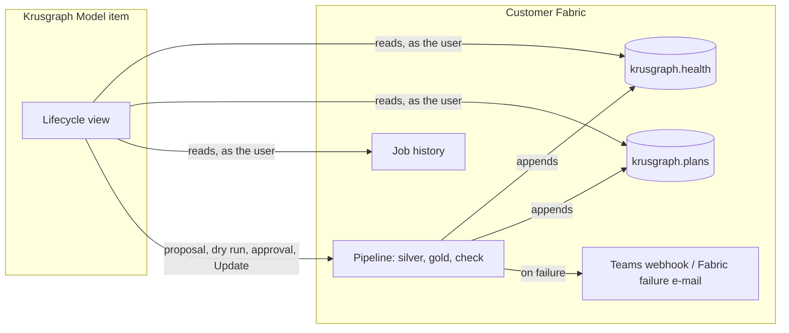
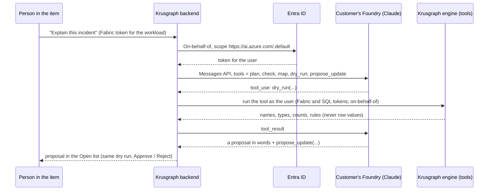

# Krusgraph Lifecycle: a data product that keeps itself healthy

Round n191. A design text, docs only, nothing implemented here. Written 10 November 2026 from the founder's note of
9 November 2026. It builds on `docs/FABRIC-IQ-AT-SCALE.md` section 8 (data products, health per product, the overview).
`docs/DATA-PRODUCTS-DESIGN.md` does not exist; section 8 of that file holds the data-product design instead.
The step before Create, getting a source system into a lakehouse with Fabric's own tools, is [CONNECT-DESIGN.md](CONNECT-DESIGN.md) (n193).

The goal in one line: **a self-playing piano.** After Create, the data product watches itself, says when something is
wrong, proposes the fix, and shows all of it in one place. A person stays in charge. Nothing changes without a reason
that is written down, and every change can be undone.

How to read this text:

- **Today** names the file that does it now. **New** is work for a later round.
- Effort is **S** (a day or less), **M** (a few days), **L** (a week or more).
- **Verified** means a public page was opened on 10 November 2026 and says it; the page and its date are given.
  **Unverified** means we found no public page that says it. Treat it as an open question.
- Only public Microsoft Learn pages and Anthropic's public documentation are cited. No non-public material is used.
- Krusgraph is independent. "Works with Claude" and "works with Microsoft Fabric" describe compatibility only. There is
  no partnership with Anthropic or Microsoft, and this text does not imply one.

---

## 0. What exists today

From one checked plan, the Krusgraph Model item creates silver and gold, a pipeline (with optional Run once and
Schedule), a semantic model (refreshed), a report, an API for GraphQL, an ontology, a data agent (one layer, optional
publish) and an App (Rayfin, preview). These are the parts the Lifecycle builds on:

| Part | What it does now | File |
|---|---|---|
| Plan id and schema fingerprint | Every output records the plan it was built from, in `outputs.json` `created[].plan` and as a marker in its Fabric description | `workload_api.py` (`plan_mark`, n180), `review.py` (`plan_id`) |
| "Built from a different plan" | On reopen, an item from another plan is not skipped; its card offers Update (dry run first, then `confirm_update`) or a new name | `workload_api.py` (n180), `buildWords.ts` |
| The check notebook | Last step of the pipeline. Keys unique and not NULL, orphans per relationship, gold row count and each amount's SUM before and after the join. A failure fails the run | `pipeline.py` (`CHECK_CODE`, `check`, `raise_if_failed`) |
| Quarantine | The silver notebook moves NULL keys, duplicate keys and orphan references to `krusgraph_quarantine`, with the rule and the reason | `silver.py` |
| Fix proposals | For a failed key or relationship: keep one per key, quarantine or set NULL; a dry run of the changed notebook | `fixes.py`, `fix_plan.py` |
| Drift monitor | A nightly notebook and pipeline. It saves the plan as a snapshot in `krusgraph.plans`, compares it with the last one (tables, columns, types, keys, relationships) and posts a summary to a Teams or Power Automate webhook. An MCP tool, not yet an item output | `monitor.py`, `drift.py` (`plan_snapshot`, `snapshot_diff`, `compare`), `server.py` (`drift_monitor_draft`, `create_drift_monitor`) |
| Run results | The latest job instances of a pipeline or notebook, per activity, with Fabric's error text and a category from a small catalogue (import error, table not found, permission denied, capacity paused or throttled, timeout) | `run_results.py` |
| Run once and schedule | Starts one run, reads its end, creates or updates the one schedule Krusgraph made | `pipeline_jobs.py` (n185) |
| The finish | The summary after Create, kept in `outputs.json` and shown again on reopen | `createWords.ts` |
| No AI | Krusgraph for Fabric uses no AI model | `offering.py` (`NO_AI`) |

What is missing: health **over time**, one catalogue of issue classes, fixes that come to the user without being
asked for, a level of autonomy the owner chooses, an audit trail, and one view that shows it all.

One design rule shapes everything below. **Krusgraph holds no long-lived tokens.** Every call runs as the signed-in
user, on behalf of that user (`entra.OnBehalfOf`), while the item is open. So anything that must happen while nobody
is looking runs **inside the customer's Fabric**, in the pipeline Krusgraph made, under the customer's own identity.
The item reads the results when a person opens it.



---

## 1. Detect

### 1.1 Health per run

The check notebook already counts everything we need. Today it prints the counts and fails or passes. New: it also
**appends one row per check** to a table Krusgraph makes, next to `krusgraph.plans`.

Table `krusgraph.health` (`krusgraph_health` on a lakehouse without schemas):

| Column | Example | Note |
|---|---|---|
| `run_id` | the job instance id | Links the row to Fabric's job history |
| `checked_at` | 2026-11-10T02:04:11Z | UTC |
| `plan_id`, `schema_fingerprint` | as in `outputs.json` | Which plan the run checked against |
| `check` | `key`, `orphans`, `join_rows`, `join_sums`, `row_count`, `freshness`, `quarantine` | One of a fixed list |
| `object` | `silver.orders`, `gold.v_order_lines` | A table or a view |
| `rule` | `K1`, `R2` | The engine's named rule |
| `status` | `pass`, `warn`, `fail` | |
| `count` | 37 | Rows, duplicates, orphans or quarantined rows |
| `baseline` | 2 | The same count in the previous run with the same plan |

**Never a row value.** The table holds names, rules, statuses and counts. It does not hold key values, sample rows or
amounts. For `join_sums` it stores only whether the sums match (`pass` or `fail`), not the sums: an amount total can be
sensitive (revenue). The quarantine table keeps its rows as today (`row_json`, in the customer's lakehouse); the health
table only counts them per rule.

The five health checks:

| Check | How | Today | New |
|---|---|---|---|
| Keys unique, not NULL | `COUNT(*)` against `COUNT(DISTINCT key)` and NULL count | `pipeline.py` `check` | Append the row |
| Orphan counts | `NOT EXISTS` per relationship | `pipeline.py` `check` | Append the row; compare with `baseline` |
| Sums match | Row count and SUM of each amount before and after the gold join | `pipeline.py` `check` | Append pass or fail only |
| Row counts | `COUNT(*)` per silver table and gold view | Partly (gold views) | Every silver table too; `warn` when the count moves more than the owner's threshold (default: falls by 50 % or more) |
| Freshness | The time of the last write to each source table, from Delta's table history (a commit time, not a value in the rows) | New | `warn` after the owner's limit (default: 2 schedule intervals), `fail` after 3 |

Risk: the check notebook is self-contained since n140 (no `%pip`, no import of this library). The new code must be
written into the cell verbatim, like `CHECK_CODE`, and run on SQLite and local Spark in the tests, as today.

### 1.2 Drift against the plan

`monitor.py` already compares today's plan with the last saved one. The Lifecycle compares today's schema with **the
plan the outputs were built from**: the snapshot in the item's `review.json` for the `plan_id` in `outputs.json`. The
diff is `drift.snapshot_diff`; what it reaches is `drift.compare` (per API) and the lineage edges.

| Drift | Found by | Today |
|---|---|---|
| New column | `snapshot_diff` (columns added) | Yes, nightly monitor |
| Dropped column | `snapshot_diff` (columns removed) | Yes |
| Retyped column | `snapshot_diff` (types changed) | Yes |
| New table | `snapshot_diff` (tables added) | Yes |
| Dropped table | `snapshot_diff` (tables removed) | Yes |
| Key or relationship no longer inferred | `snapshot_diff` (keys, relationships) | Yes |

New: the snapshot step moves into the pipeline (a cell before silver), so drift is found on every run, not only by a
separate nightly monitor. A drift that breaks silver (a dropped key column) stops the run **before** anything is
written, with the reason. A drift that does not break it (a new column) is recorded and the run goes on.

### 1.3 Run failures and capacity limits

| Signal | Source | Status |
|---|---|---|
| Run status, start, end, `failureReason` (errorCode, message, isRetriable) | Fabric REST, Job Scheduler: List Item Job Instances, Get Item Job Instance | Verified, already used: `run_results.py` cites microsoft/fabric-rest-api-specs 6f817cb, `platform/swagger.json` |
| Per-activity status of a pipeline run | "Query activity runs" on Learn's `data-factory/pipeline-rest-api-capabilities.md` | Cited in `pipeline_jobs.py`; the page names no scope, so treat a refusal as normal |
| Capacity throttled or paused | The run's error text, matched by `run_results.py`'s `capacity_paused_or_throttled` entry ("CapacityNotActive", "TooManyRequestsForCapacity", "HTTP 430", ...) | Heuristic, marked as one in the code |
| Capacity load before a failure | Fabric's Capacity Metrics app | Unverified: we found no documented API that returns utilisation for one item. Krusgraph does not read it; the view links to the app |
| Job history kept by Fabric | Workspace monitoring, table `ItemJobEventLogs`: item, job type, status, start and end, executing principal | Verified: Learn `fabric/fundamentals/item-job-event-logs` (ms.date 2026-01-09) and `workspace-monitoring-overview` (ms.date 2026-08-13). Opt-in by the customer, uses capacity, kept 30 days by default |

Learn notes for workspace monitoring that its logs "can contain customer-provided data, including sensitive or
personally identifiable information". Krusgraph reads only status columns from it, and only when the customer turned it
on. The job history API (`run_results.py`) stays the default source because it needs nothing extra.

The Fabric REST specification says "most items have a limit of 100 recently completed entities" in job history (cited in `run_results.py`). So
the health table, not Fabric's job history, is the memory of the data product.

### Effort and order (detect)

| # | Work | Effort | Risk |
|---|---|---|---|
| D1 | `krusgraph.health` written by the check notebook | M | The verbatim code must stay in step with `pipeline.check`; tested on SQLite and Spark |
| D2 | Row counts for every silver table, freshness from Delta history | S | Delta history read in a Fabric notebook: tested locally only until a live run |
| D3 | Snapshot and drift as the pipeline's first cell | M | A wrong "breaking" verdict would stop good runs; start with `warn` only |
| D4 | The item reads health, plans and job history on open | M | Read scopes exist (`Item.Read.All`); the SQL endpoint may lag behind a fresh Delta write (Unverified how long) |

---

## 2. Diagnose: a fixed catalogue of issue classes

A diagnosis is a lookup, not a guess. Each class has one recogniser over the signals of section 1. A signal that no
class matches is shown as **Unclassified** with Fabric's own text.

| Class | Recognised by | Severity |
|---|---|---|
| `schema_drift.added_column` | Column in today's snapshot, not in the plan's | amber |
| `schema_drift.dropped_column` | Column in the plan, not today; red when it is a key, a reference or a measure's column | amber or red |
| `schema_drift.retyped_column` | Same column, other type | amber; red when silver's cast would fail |
| `schema_drift.new_table` | Table in the source, not in the plan | info |
| `schema_drift.dropped_table` | Table in the plan, not in the source | red |
| `orphan_spike` | `orphans` count above `baseline` × the owner's factor (default 3) and above an absolute floor (default 10) | amber |
| `duplicate_keys` | `key` check `fail` | red |
| `sums_mismatch` | `join_sums` `fail` (a gold join that adds or loses amounts) | red |
| `row_drop` | `row_count` `warn` | amber |
| `stale_data` | `freshness` `warn` or `fail` | amber or red |
| `failed_run` | Job instance `Failed`; the sub-class is `run_results.classify` (import error, table not found, timeout, unknown) | red |
| `capacity_limit` | `classify` gives `capacity_paused_or_throttled` | amber (not a data problem) |
| `permission_lost` | `classify` gives `permission_denied`, or the item's own read of an output answers 403 | red |
| `item_deleted` | An id in `outputs.json` `created[]` answers 404 on Get Item | red |
| `item_changed_outside` | The item exists, but its description marker (n180) is gone or names another plan | amber |

Health per data product is the worst open class: any red is **red**, else any amber is **amber**, else **green**.
The view always writes the word next to the colour.

Effort: the catalogue as data with its recognisers, unit-tested on recorded signals: **M**. Risk: thresholds that are
too tight make noise. Defaults are conservative and the owner can change them per product.

---

## 3. Propose: the fix for each class, with a dry run

Every proposal is built on the existing Update path (n180): the same tool function that made the output, run as a dry
run with the changed plan, then `confirm_update`. A proposal holds: the class, the evidence (counts, never values), the
change in words, the dry run's diff, what it touches downstream, and its undo.

| Class | Proposed fix | Dry run shows | Built on |
|---|---|---|---|
| `added_column` | Add it to silver (and to the model if the owner ticks it) | The silver notebook's new cell; no model change unless ticked | `silver.spec`, Update |
| `dropped_column` | Remove it from silver, gold and the model; list each measure, report visual and API field that used it | The removals and what breaks | `drift.compare`, lineage |
| `retyped_column` | Update the silver notebook's cast; for a narrowing type, quarantine rows that do not cast | The changed cast and a count of rows that would not cast | `silver.py`, Update |
| `new_table` | Add it to the plan: the review step opens with the new table and its inferred keys and links | A new plan; the user checks it as usual | `review.py` (`since_previous`) |
| `dropped_table` | Take it out of the plan and every output, or stop and ask | The outputs that lose a table | Update |
| `orphan_spike` | Quarantine the orphans (they already go there by default) and alert the owner with the counts | The quarantine count per rule | `silver.py`, `fixes.for_orphans` |
| `duplicate_keys` | Keep one row per key (with the winner rule), or quarantine | The changed silver step | `fixes.for_key`, `fix_plan.propose` |
| `sums_mismatch` | Show the join that fans out; propose the header-amount split | The changed gold view | `fixes.for_flat_amount` |
| `row_drop` | No change. Ask the owner whether the source is complete | Nothing | — |
| `stale_data` | No change. Show the source's last write and the schedule | Nothing | `pipeline_jobs.py` |
| `failed_run` | Re-run once, with Fabric's error shown and the catalogue's next step | The run that would start | `pipeline_jobs.py` (run once) |
| `capacity_limit` | Re-run once after the owner's wait (default 30 minutes); link to the capacity | The run and when | `pipeline_jobs.py` |
| `permission_lost` | No change. Say which identity lacks which role; a person grants it | The Entra or Fabric steps | `run_results.py` text |
| `item_deleted` | Re-create the item from the recorded plan, or forget it | The Create dry run for that one output | Create, `outputs.json` |
| `item_changed_outside` | Show the difference; offer Update (overwrite) or Keep (record it as accepted) | The Update dry run | n180 |

Effort: **L** for all of them. Order: `failed_run`, `capacity_limit`, `orphan_spike`, `added_column`, `new_table`
first (they reuse what exists), then the rest. Risk: an Update overwrites hand edits in a notebook. The dry run must say
so, as it does today for n180.

---

## 4. Autonomy levels

The owner sets one level per data product. **Level 0 is the default.**

| Level | What happens | Who acts |
|---|---|---|
| **0, suggest only** | Detect, diagnose, propose. Nothing is applied until a person clicks Approve | A person |
| **1, safe classes** | Re-run once and quarantine are applied without asking; the owner is notified at once and can undo | The pipeline, in the customer's Fabric |
| **2, owner's rules** | Changes that match a rule the owner wrote (for example "add new nullable text columns to silver") are applied; the rest waits | The pipeline, or the next approver session (see below) |

Which class may run at which level:

| Class | Level 0 | Level 1 | Level 2 | Why |
|---|---|---|---|---|
| `failed_run` (re-run once) | suggest | auto | auto | A re-run changes no definition and is idempotent: silver overwrites, gold views are recreated |
| `capacity_limit` (re-run once later) | suggest | auto | auto | Same; waiting is the fix |
| `orphan_spike` (quarantine and alert) | suggest | auto | auto | Silver already quarantines by default; level 1 only adds the alert and keeps the run green when the spike is under a hard cap |
| `added_column` | suggest | suggest | rule | Changes a definition and the model; needs the owner's rule |
| `new_table` | suggest | suggest | suggest | A plan change needs the row check and a person's review |
| `retyped_column` | suggest | suggest | rule (widening only, such as int to bigint) | Narrowing can lose data |
| `dropped_column`, `dropped_table` | suggest | suggest | suggest | Breaks reports and apps |
| `duplicate_keys`, `sums_mismatch` | suggest | suggest | suggest | The winner rule is a business decision |
| `permission_lost`, `item_deleted`, `item_changed_outside` | suggest | suggest | suggest | Needs a person with rights |
| `row_drop`, `stale_data` | inform | inform | inform | Nothing to apply |

How level 1 works without Krusgraph holding a token: both safe actions run inside the pipeline Krusgraph made.

- **Re-run once:** the Notebook activities get a retry count of 1 and a retry interval in their policy. Learn's
  `data-factory/activity-overview.md` lists Retry and Retry interval as activity settings (cited in `pipeline.py` for
  the dependency conditions; the retry fields themselves were not opened in this round, so their JSON names are
  Unverified). For `capacity_limit` the wait is the retry interval.
- **Quarantine and alert:** the silver notebook already quarantines. The check notebook posts to the owner's webhook
  when `orphan_spike` fires (the existing `monitor.send` code, written verbatim into the cell).

Level 2 changes item definitions, which needs a token with write rights. Two ways, both honest about who acts:

1. **At the next open.** The proposal is prepared and marked "auto under rule X". The first person with approval rights
   who opens the item sees "2 changes applied under your rules" and they run in that session, as that person.
2. **In the customer's Azure.** With Krusgraph Open Source running in the customer's tenant under a managed identity
   (section 7.3), level 2 can run on a schedule. Krusgraph's hosted service never does this.

**Every change is versioned and can be undone.**

- Before an Update, the item saves the output's current definition (Get Item Definition) as version *n*.
- Undo writes version *n* back through the same Update path, with its own dry run and its own audit row.
- A re-run has no definition to undo; its "undo" is to stop retrying (set level 0).
- A quarantine change is undone by restoring the silver notebook's previous version and re-running.
- Nothing changes without a recorded reason: the class, the evidence, the level or the approver, the plan version.

Where versions live: a part in the Krusgraph Model item's own definition (`lifecycle/versions/<item>/<n>.json`), next to
`outputs.json`. Unverified: the size limit of a workload item's definition. If it is too small, the versions go to the
lakehouse (`Files/krusgraph/versions/`), written by the pipeline.

Effort: levels and the class table **S**; retry policy and alert in the pipeline **M**; versions and Undo **M**;
level 2 rules **L**. Risk: an automatic re-run can hide a real fault. Level 1 retries **once** per run, never in a loop,
and every retry is in the timeline.

---

## 5. Govern

### 5.1 Approvals

| Question | Answer |
|---|---|
| Who may approve | The data product's owner (section 8.1 of `FABRIC-IQ-AT-SCALE.md`: a person or group in Entra, kept in `outputs.json`) |
| What else is checked | Fabric itself: the approver must have write rights on each item the Update touches. Krusgraph never grants a right |
| No owner yet | Proposals wait. The view says "Choose an owner to approve changes" |
| Groups | An owner group needs Microsoft Graph to read membership (a new delegated scope). Until then, owners are listed people. Unverified which scope the workload app can get admin consent for |
| Four eyes | Optional per product: whoever wrote a level 2 rule cannot approve their own rule's first change |

### 5.2 The audit log

One entry per event, append only. Four kinds: **detection**, **proposal**, **decision** (approve, reject, undo, auto
under level or rule), **change** (what was written, with the result).

| Field | Example |
|---|---|
| `at` | 2026-11-10T07:12:03Z |
| `kind` | `decision` |
| `who` | Entra object id and display name, or `pipeline` with the run id |
| `class` | `added_column` |
| `plan_id` before and after | `a1b2…` → `c3d4…` |
| `items` | ids from `outputs.json` |
| `reason` | "Approved: new column discount_code is needed by Finance" |
| `version` | the saved version number, for Undo |

Detections are written by the pipeline into `krusgraph.health`. Proposals, decisions and changes are written by the
item into a part of its own definition (`lifecycle/log.json`), the way it saves `outputs.json` today. Long logs roll over
to the lakehouse. The log holds no row values and no tokens, like every Krusgraph answer.

### 5.3 Notifications

Krusgraph sends no e-mail of its own. It uses what Fabric and Teams document:

| Channel | How | Status |
|---|---|---|
| Teams channel | A Teams workflow "When a Teams webhook request is received"; the pipeline posts an Adaptive Card. The webhook address is a pipeline parameter, never in code | Exists: `monitor.py` (`teams_message`, `send`) |
| E-mail through Power Automate | The same webhook, pointed at a Power Automate HTTP trigger that sends mail | Exists (`monitor.py` docstring) |
| Fabric's failure e-mail | "Notifications for failed scheduled jobs": free, scheduled runs only, recipients are Entra users or groups | Verified: Learn `fabric/admin/monitoring-hub-alerts` (ms.date 2026-09-21, preview). Set by a person in the Monitor hub; the view gives the steps |
| Fabric Activator alerts | More job events (Started, Succeeded), richer notifications, automated actions; needs workspace monitoring; uses capacity | Verified: same page. Optional; the view links to it |
| Manual | The view shows the incident and the steps; a person tells others | Always available |

No documented API to create the schedule failure e-mail was found. Unverified; the view shows the manual steps.

### 5.4 Alignment with Fabric's own monitoring and governance

- **Monitor hub** (Learn `fabric/admin/monitoring-hub`, ms.date 2026-09-04, preview) is "the unified observability
  pane in Microsoft Fabric": job runs, alerts, capacity, agents. The Lifecycle view does not replace it. Every run in
  the timeline links to the Monitor hub. The Lifecycle view adds what the Monitor hub cannot know: the plan, the row
  check, the drift against the plan, and the fix.
- **Operations agent** (preview): Learn describes a read-only investigation of failed pipeline runs, started from the
  Monitor hub. Krusgraph does not duplicate it. For `failed_run` the view can say "You can also investigate this run
  in the Monitor hub".
- **Workspace monitoring** is the customer's choice. Krusgraph reads its job table only when it is on (section 1.3).
- **Domains, endorsement, Purview**: as in `FABRIC-IQ-AT-SCALE.md` section 8, Krusgraph aligns and does not duplicate.
  It never sets endorsement.

Effort: approvals **S**, audit log **M**, notification wiring **S** (it exists), Learn-linked manual steps **S**.

---

## 6. The Lifecycle view in the item

A new tab in the Krusgraph Model item, next to the plan map, the flow and the code (layers b, c, d of section 8.2 in
`FABRIC-IQ-AT-SCALE.md`). It reads `outputs.json`, `lifecycle/log.json`, `krusgraph.health`, `krusgraph.plans` and the
job history, as the signed-in user.

```
 customers  ·  owner: Sales team  ·  level 0 (suggest only)          Health: AMBER  [amber]
 ─────────────────────────────────────────────────────────────────────────────────────────
 Plan versions   v1 a1b2 ──────────────────────────────► v2 c3d4 (approved 8 Nov, Anna)
 Runs            ● ● ● ● ✕ ● ● ● ● ●                     (● passed  ✕ failed  ↻ re-run)
                 1  2  3  4  5  6  7  8  9  10 Nov
 Health          green ────────── red ── green ───── amber
 ─────────────────────────────────────────────────────────────────────────────────────────
 Open
  [amber] orphan_spike   silver.orders → customers: 37 orphans (was 2)      10 Nov 02:04
          Fix: quarantine and alert (already in quarantine: 37 rows, rule R2)
          [See dry run]  [Approve]  [Reject]

  [info]  new_table      source has table returns (not in the plan)         10 Nov 02:01
          Fix: add it to the plan and check it
          [See dry run]  [Approve]  [Reject]

 Done
  [red→green] failed_run  5 Nov, capacity throttled; re-run by Anna, passed   [Undo n/a]
  [change]    added_column discount_code to silver (v2)  8 Nov, Anna         [Undo]
 ─────────────────────────────────────────────────────────────────────────────────────────
 Runs in the Monitor hub ↗   Capacity ↗   Audit log (24 entries) ↓
```

- **Timeline**: plan versions, runs (from job history and `krusgraph.health`), health per day, incidents.
- **Open**: proposals with See dry run, Approve, Reject. Approve asks for a reason (one line, required).
- **Done**: what changed, who, when, with Undo where a saved version exists.
- Colour is never the only signal: each line says green, amber or red in words.
- Keyboard: the same rules as the map and the flow today.

How it connects:

- **The data-product overview** (layer a, `FABRIC-IQ-AT-SCALE.md` section 8.2, round V3): each product box takes its
  health colour from this view's worst open class. Clicking the colour opens this tab.
- **The finish banner** (`createWords.ts`): after Create it says "Health: not checked yet. The first run fills the
  Lifecycle tab." After the first run it shows the health word and the number of open proposals, with a link here.
- **Cards marked "built from a different plan"** (n180) become proposals of class `item_changed_outside` in the same
  list, so there is one place for every pending change.

Effort: **L** (timeline, proposal list, dry run panel, Undo). Risk: too much on one screen. The first version shows
Open and Done only; the timeline comes second.

---

## 7. The Claude agent in the customer's own Azure (opt-in, off by default)

Krusgraph for Fabric keeps its "no AI" default (`offering.py` `NO_AI`). Everything in sections 1 to 6 works without
any AI model. The agent is an extra the customer turns on, runs in the customer's Azure, and pays for on the customer's
Azure invoice. It works with Claude; it is not a partnership.

Section 8.3 of `FABRIC-IQ-AT-SCALE.md` lists what must be true before any AI enters the item. This design meets each
point: opt-in per tenant, the customer's own Azure, proposals only, the same row check and dry run, "no AI" updated
everywhere on the same day, and the guide without AI stays the default.

### 7.1 What the customer deploys

Claude in Microsoft Foundry, as a **Hosted on Azure** deployment.

| Fact | Status |
|---|---|
| Two hosting options. Hosted on Azure: "Anthropic-operated service running on Azure infrastructure". For it, "prompts and completions remain within Azure. Only usage metadata and content flagged by Anthropic's safety systems egress to Anthropic." | Verified: Anthropic's docs, `platform.claude.com/docs/en/build-with-claude/claude-in-microsoft-foundry` (read 10 Nov 2026) |
| Billing: Azure Marketplace, in Claude Consumption Units, "invoiced monthly in arrears on your Azure bill" | Verified: same page |
| Deployment types: Global Standard for all Claude models; Data Zone Standard for some Hosted on Azure models, **US only** | Verified: Learn `azure/foundry/foundry-models/how-to/use-foundry-models-claude` (ms.date 2026-09-21) |
| **Sweden Central** is listed for Global Standard, including the Hosted on Azure versions (version 2) of `claude-opus-5-5`, `claude-opus-5`, `claude-sonnet-5`, `claude-opus-4-8` and `claude-haiku-4-5` | Verified: Learn `azure/foundry/foundry-models/concepts/models-from-partners`, "Region availability by deployment type" (ms.date 2026-09-21) |
| **EU Data Zone**: "Not available" for Claude on that page | Verified, same page |
| Global Standard: "Microsoft processes prompts and responses in any Azure region where you deploy the model." Whether processing stays inside the EU for a Sweden Central Global deployment | Unverified. We read Global as **not** an EU residency guarantee. The customer's DPO decides |
| Not on Hosted on Azure: code execution, web search and fetch beyond the basic versions, Agent Skills, programmatic tool calling, Files API. Not on Foundry at all: Message Batches, Models API, server-side fallback | Verified: Anthropic's page above. The agent needs none of them: its tools are Krusgraph's own |
| Subscription: paid Azure subscription with a pay-as-you-go billing method; CSP subscriptions not supported | Verified: Learn `use-foundry-models-claude` |

Model choice: `claude-opus-5-5` for diagnosis and proposals. `claude-haiku-4-5` (Hosted on Azure in Sweden Central) or
a newer Haiku where the customer's region offers it, for bulk text (7.4). The deployment name is the customer's; the
item stores only the resource name and the deployment name.

### 7.2 How the item calls it



- **No keys stored by Krusgraph.** The backend exchanges the user's workload token on-behalf-of the user for a token
  with scope `https://ai.azure.com/.default`, and sends it as `Authorization: Bearer`. Both Anthropic's page and Learn
  document Entra ID for Claude in Foundry with that scope; Learn's troubleshooting says the user needs the
  **Cognitive Services User** role on the resource (Anthropic's page also names **Foundry User**).
- Unverified: that the workload's Entra app can get admin consent for that delegated scope and use it on-behalf-of.
  Learn's `configure-entra-id` page was not opened in this round. Round A1 (section 8) checks it first.
- The endpoint is `https://<resource>.services.ai.azure.com/anthropic/v1/messages` (Verified, both pages).
- The token lives only for the request, like the Fabric tokens today. Nothing is written to disk or logs.
- Prompts pass through Krusgraph's backend (Azure, Sweden Central) on their way to the customer's Foundry. Krusgraph
  keeps no copy. The privacy page and `docs/TRUST.md` must say this before the round ships.

### 7.3 What the agent may and may not do

| May | May not |
|---|---|
| Read the plan, the review and the map (`plan`, `map`) | Read rows. `sample_rows` is not a tool for the agent unless the owner turns on "allow row values" |
| Run the row check (`check`): counts and verdicts | Run any SQL it writes itself |
| Run a dry run of any output (`dry_run`) | Call Update, Create, schedule, publish or delete |
| Propose a change (`propose_update`), which lands in the Open list with its dry run | Approve, reject or undo anything |
| Explain an incident in plain words, citing the health rows and Fabric's error class | Change autonomy levels, owners or rules |
| Draft descriptions and synonyms for the model (as a proposal) | Use web search, web fetch or code execution (not declared; not offered on Hosted on Azure anyway) |

Every proposal from the agent goes through the same dry run, approval and audit as section 4 and 5. The audit row says
`who: agent (claude-opus-5-5 via <resource>) on behalf of <person>`. At level 1 or 2 the agent's proposals are still
**never** auto-applied: the safe classes are applied by the pipeline's own rules, not by the agent.

### 7.4 Variants

**a. A Fabric notebook for bulk tasks.** Descriptions for every column, synonyms for the semantic model, glossary
drafts. A notebook in the customer's workspace uses Anthropic's Python SDK with the Foundry client:

```python
# Sketch, not shipped. The SDK class and parameters are from Anthropic's Foundry page (Entra ID example).
from anthropic import AnthropicFoundry

client = AnthropicFoundry(
    base_url="https://<resource>.services.ai.azure.com/anthropic",
    # Unverified: that notebookutils returns a token for this audience. Fallback: a key the customer keeps in
    # their own Key Vault, read with notebookutils.credentials.getSecret (never in the notebook text).
    azure_ad_token_provider=lambda: notebookutils.credentials.getToken("https://ai.azure.com"),
)
msg = client.messages.create(
    model="<your deployment name>",
    max_tokens=4000,
    output_config={"effort": "low"},
    messages=[{"role": "user", "content": prompt_with_names_types_and_rules_only}],
)
```

The output is a JSON file of proposals, which the item imports into the Open list. The notebook writes nothing into the
model itself. Message Batches are not on Foundry, so the notebook sends one table per request with a small fixed
concurrency.

**b. Krusgraph Open Source and Foundry, all in the customer's Azure.** The MIT code runs as a container app in the
customer's tenant (`deploy/azure_containerapp.py` shows the shape) with a managed identity that has Cognitive Services
User on the Foundry resource and the Fabric rights the owner chooses. No data and no prompt leaves the customer's Azure.
This is the only variant where level 2 can run on a schedule without a person present.

### 7.5 Cost control

| Lever | Default |
|---|---|
| The agent is off | Yes, per tenant, until an administrator turns it on |
| One request per click | No background loop; nothing runs while nobody asks |
| Token cap per product per month | Set by the owner; the item counts `usage` from each answer and stops at the cap with a clear message |
| Effort | `low` for explanations and bulk text; `medium` for proposals |
| Prompt caching | The tool list and the plan go first so repeated questions reuse them |
| `max_tokens` | Bounded per task |
| Azure budgets | The view links to Azure Cost Management for the Foundry resource; Krusgraph does not read billing |

### 7.6 Prompt injection

Column names, table names, descriptions and Fabric's error messages are data the customer's sources control. Someone
can write "ignore your instructions" into a column comment. The design assumes they will.

- The agent has no tool that changes anything. The worst it can do is make a bad proposal, which a person sees with
  its dry run.
- Tool results are sent as tool results, never as instructions. The system prompt says that names and messages are
  data.
- **Row values are never sent** unless the owner turns on "allow row values" for that product, and then only
  `sample_rows`' capped sample.
- Fabric's error text can contain values (a failed cast quotes the text). By default the agent gets the error class,
  the errorCode and `isRetriable`; the full message only when the owner allows row values.
- Every proposal is checked by the engine: a key or link the agent proposes is only accepted after the row check, as
  today.

Effort for section 7: **L** in total (A1 to A3 in section 8). Risks: residency (no EU Data Zone; Global is not an EU
guarantee), the on-behalf-of consent for `ai.azure.com` (Unverified), cost surprises (mitigated by the cap), and the
"no AI" promise (mitigated by off by default and clear words wherever it is on).

---

## 8. The build rounds this implies, in order

1. **Health over time and alerts.** The check notebook appends to `krusgraph.health` (keys, orphans, sums as pass or
   fail, row counts, freshness from Delta history), and the snapshot and drift step moves into the pipeline's first
   cell, recording drift against the plan. The pipeline posts an Adaptive Card to the owner's Teams webhook when a
   check fails, and the finish gives the steps for Fabric's free failure e-mail. The item reads the table on open and
   shows one health word per product. Engine, Workload and Tests; effort M. No AI, no new scope.

2. **The Lifecycle view at level 0.** The issue catalogue as data, the proposals for `failed_run`, `capacity_limit`,
   `orphan_spike`, `added_column` and `new_table` built on the Update path, and the view with Open and Done, See dry
   run, Approve (with a reason), Reject and Undo. Versions and the audit log are parts of the item's definition. The
   overview box and the finish take their colour from here. Workload and Engine; effort L.

3. **Level 1.** Retry once on the Notebook activities (the policy fields checked against Learn first), quarantine and
   alert on `orphan_spike`, a notification for every automatic action, Undo for each, and the level switch per product
   with the class table of section 4. Engine and Workload; effort M. The remaining proposal classes of section 3 can
   join this round or the next.

4. **The agent, opt-in.** First a spike: check on-behalf-of to `https://ai.azure.com/.default` from the workload app
   and the role the user needs, against Learn. Then the tenant switch (off), the Foundry resource and deployment
   fields, the tools (plan, check, map, dry run, propose_update), the token cap, the audit rows, and every "no AI"
   text updated on the same day. Engine, Workload, Docs; effort L.

5. **The bulk notebook and the open-source path.** The notebook variant for descriptions and synonyms (proposals in a
   JSON file the item imports), and a guide for running Krusgraph Open Source with Foundry under a managed identity in
   the customer's tenant. Engine and Docs; effort M.

6. **Level 2.** The owner's rules (a small, closed list of rule shapes, such as "add new nullable columns of these
   types"), applied at the next approver's open, or on a schedule in the open-source path. Four eyes as an option.
   Workload and Engine; effort L.

---

## Sources (opened 10 November 2026)

- Microsoft Learn, `fabric/admin/monitoring-hub` (ms.date 2026-09-04): the Monitor hub, preview; job runs, alerts,
  capacity, agents; the Operations agent entry for failed pipeline runs.
- Microsoft Learn, `fabric/admin/monitoring-hub-alerts` (ms.date 2026-09-21): notifications for failed scheduled jobs
  (free, e-mail, scheduled runs only) and Activator-based alert rules (need workspace monitoring), preview.
- Microsoft Learn, `fabric/fundamentals/workspace-monitoring-overview` (ms.date 2026-08-13): the monitoring item, 30
  days default retention, capacity use, the note on customer data in logs.
- Microsoft Learn, `fabric/fundamentals/item-job-event-logs` (ms.date 2026-01-09): `ItemJobEventLogs` schema.
- Fabric REST Job Scheduler APIs as already cited in `run_results.py` and `pipeline_jobs.py`.
- Microsoft Learn, `azure/foundry/foundry-models/how-to/use-foundry-models-claude` (ms.date 2026-09-21): deployment
  types, Entra ID with scope `https://ai.azure.com/.default`, Cognitive Services User, subscription types.
- Microsoft Learn, `azure/foundry/foundry-models/concepts/models-from-partners` (ms.date 2026-09-21): region
  availability for Claude by deployment type; Sweden Central for Global Standard; Data Zone Standard US only.
- Anthropic, `platform.claude.com/docs/en/build-with-claude/claude-in-microsoft-foundry`: hosting options, billing,
  the `AnthropicFoundry` client with `azure_ad_token_provider`, features not on Hosted on Azure.

Not opened in this round (Unverified where used): Learn's `data-factory/activity-overview.md` retry fields, Learn's
Foundry `configure-entra-id` page, Fabric's throttling page, any capacity utilisation API.
