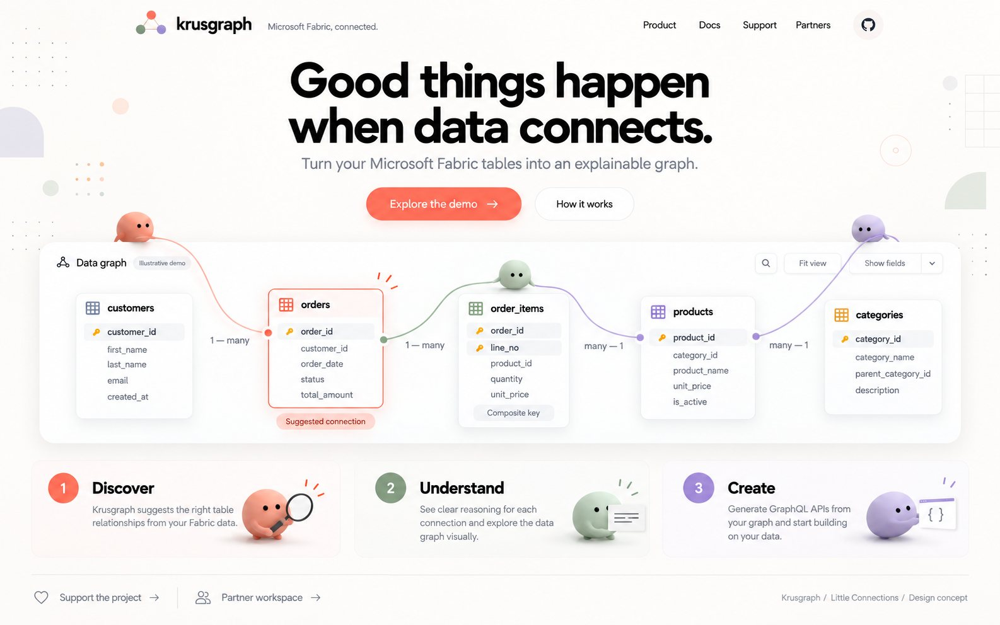
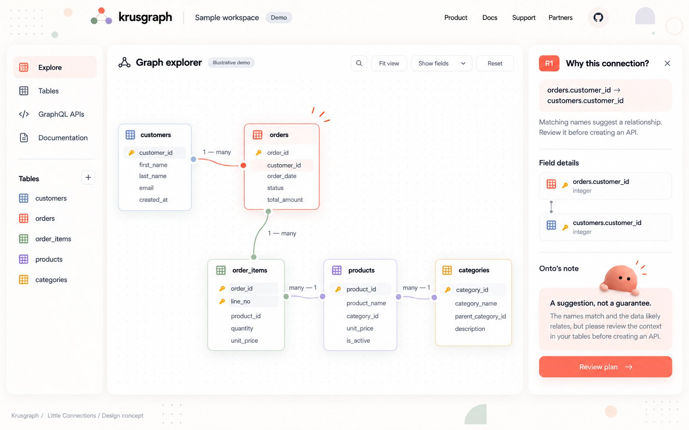
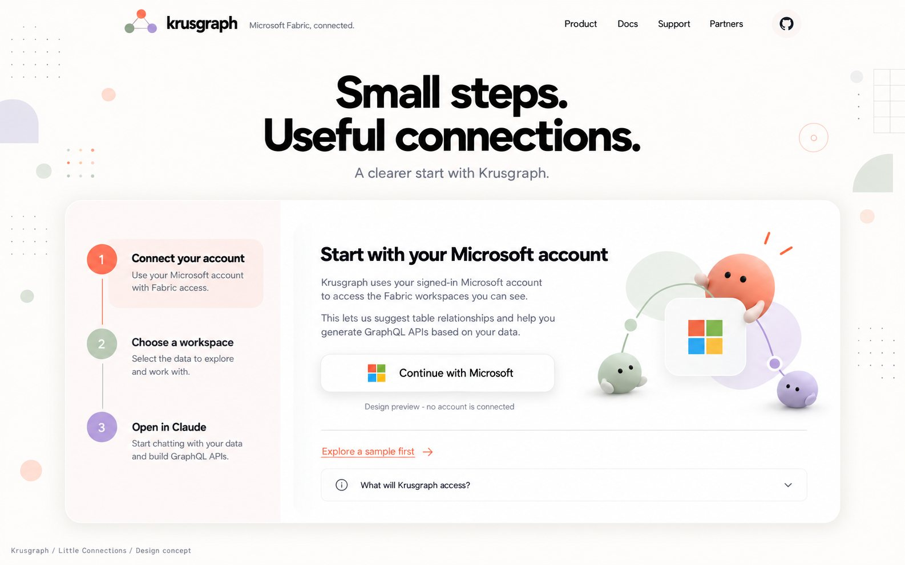
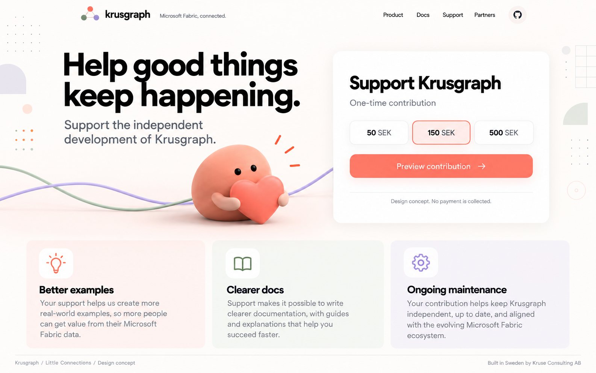
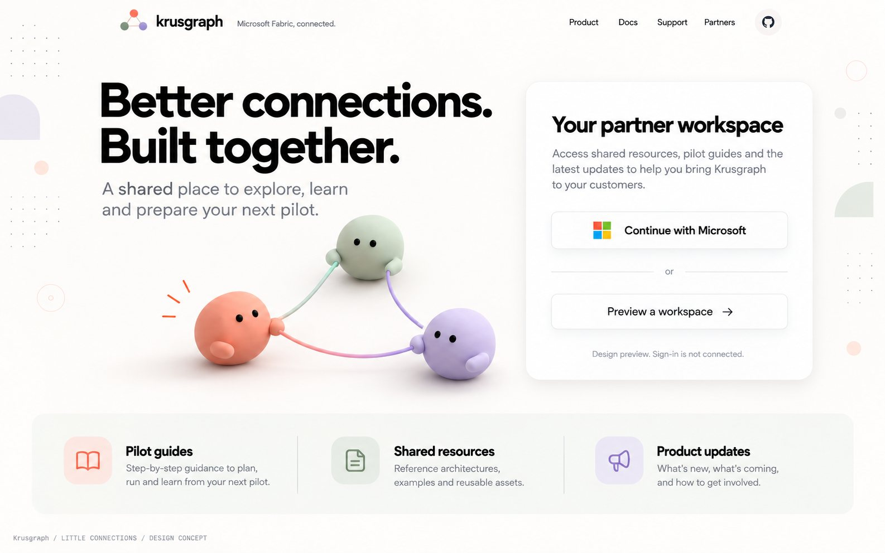
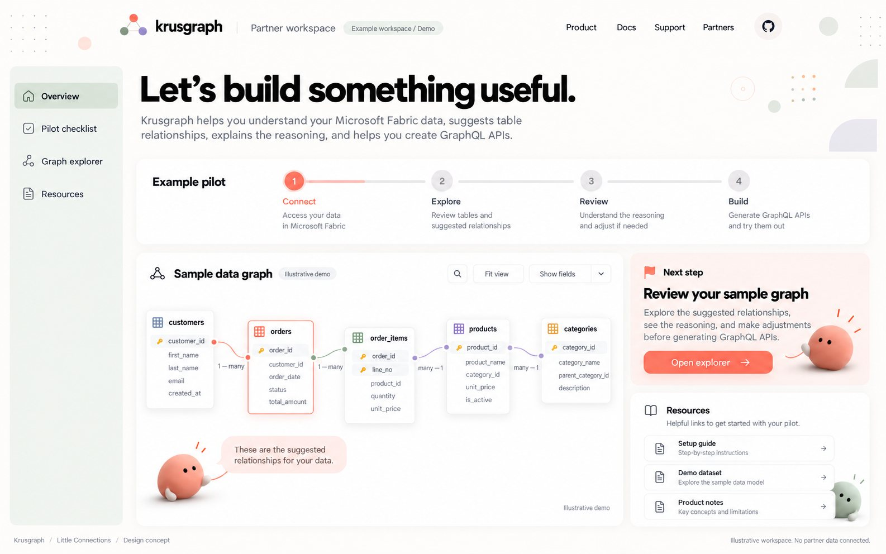

# Krusgraph - Little Connections

23 oktober 2026. Vidareutveckling av den valda designriktningen med figurerna och rubriken **Good things happen when data connects.**

## Uttryck att behålla

Varmvit bakgrund, tydlig svart typografi, korallfärgade huvudknappar, mjuka vita ytor och grafkopplingar i korall, salvia och lavendel. Figurerna är små, mjuka och enkla: två svarta ögon, diskreta armar och inget påklistrat ansiktsuttryck. De ska hjälpa besökaren att förstå produkten och visa nästa steg.

## Sidserien

### 01 Startsida

Den valda rubriken, en tydlig produktdemo och figurer som hjälper till att upptäcka kopplingarna.

**Tänkt beteende:** Peka på eller välj en tabell för att markera dess relationer. Figurerna reagerar diskret på valet.

### 02 Grafutforskaren

En större arbetsyta där relationer och förklaringar får gott om plats. Onto hjälper vid det markerade sambandet.

**Tänkt beteende:** Välj en koppling för att visa regeln bakom den. Växla mellan översikt och fält utan att tappa sammanhanget.

### 03 Kom igång

En lugn introduktion i tre steg, med den lilla korallfärgade figuren som vägvisare.

**Tänkt beteende:** En stegvis guide visar vad som behövs och låter användaren återvända till föregående steg.

### 04 Stöd projektet

En frivillig och lågmäld stödsida. Figuren med hjärtat knyter an till den valda bilden.

**Tänkt beteende:** Välj ett engångsbelopp och se vad stödet kan bidra till. Betalning kopplas in först om upplägget ska användas.

### 05 Partnerentré

En enkel entré för framtida samarbetspartner. Varm och personlig, med tydlig Microsoft-inloggning.

**Tänkt beteende:** Partnern väljer Microsoft-inloggning eller tittar på en öppen exempelarbetsyta.

### 06 Partnerarbetsyta

Ett konkret förslag på vad som kan finnas efter inloggning: pilotplan, exempelgraf och gemensamma resurser.

**Tänkt beteende:** Följ pilotens steg, öppna guider och granska en exempelgraf. Innehållet här är illustrativt.

## Figurerna - nästa steg

**Onto** är mitt förstahandsförslag som arbetsnamn. Det är kort och passar kopplingen till begrepp, struktur och ontologi. **Noodie** känns mjukare och mer lekfullt, med association till en liten figur bland noder och slingrande linjer. Inget av namnen är kontrollerat för varumärkes- eller domäntillgänglighet.

I den här serien är den korallfärgade figuren den primära guiden. Sage och lavendel fungerar som stödfigurer kring kopplingar och samarbete; de behöver inte få egna namn ännu. Ett alternativ är att kalla hela familjen för **Noodies** och huvudfiguren för **Onto**.

När sidriktningen känns rätt kan nästa separata omgång fokusera på figurernas silhuett, proportioner och rörelser: nyfiken, funderar, visar ett samband, väntar på granskning och tackar. Behåll teknisk osäkerhet tydlig: en glad figur ska aldrig få ett föreslaget samband att se verifierat ut.

## Status

Detta är sex statiska sidbilder plus det valda originalkonceptet, inte sex nya implementerade hemsidor. Grafutforskning, kom-igång-guide, betalning och partnerinloggning är designförslag. Ingen riktig inloggning eller betalning är ansluten. Ingen ändring har publicerats på krusgraph.com.

Beloppen 50, 150 och 500 SEK är exempel på frivilligt projektstöd, inte beslutad produktprissättning eller ett välgörenhetslöfte. Partnerarbetsytan visar exempel, inte verkliga partneruppgifter.

Bilderna är skapade med inbyggd bildgenerering med det valda originalet som stil- och figurreferens. Småtexter och diagram i bilderna ska granskas mot den verkliga produkten vid implementation. De fullständiga prompterna finns i IMAGE-PROMPTS.md.

